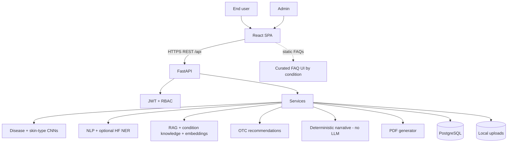

# DermaSoul AI — Project Documentation

**Status:** Production-oriented full-stack application  
**Last verified against repository:** 8 May 2026

---

## Table of contents

1. [Executive summary](#1-executive-summary)  
2. [Clinical and legal disclaimer](#2-clinical-and-legal-disclaimer)  
3. [Architecture overview](#3-architecture-overview)  
4. [Artificial intelligence and machine learning](#4-artificial-intelligence-and-machine-learning)  
5. [Repository layout](#5-repository-layout)  
6. [Core user journeys](#6-core-user-journeys)  
7. [API surface (summary)](#7-api-surface-summary)  
8. [Configuration](#8-configuration)  
9. [Data persistence](#9-data-persistence)  
10. [Security model](#10-security-model)  
11. [Operational runbook](#11-operational-runbook)  
12. [Documentation index](#12-documentation-index)  
13. [Roadmap and technical debt](#13-roadmap-and-technical-debt)

---

## 1. Executive summary

**DermaSoul AI** is a web application that supports **educational, safety-aware skin assessment**: users submit a photo plus structured symptom and context text, the backend combines **computer vision**, **text processing**, **rule-based triage**, and **retrieval-augmented educational content**, then stores a rich **consultation** record. The React frontend provides analysis, history, **condition-specific FAQs** (curated text, not generative chat), PDF export, product and education browsing, and an admin area.

**Intentionally not included:** conversational **large language models** (no local Qwen/Ollama path, no `…/messages` chat API). Narrative blocks on the consultation are assembled **deterministically** from structured fields.

---

## 2. Clinical and legal disclaimer

The system provides **decision support and education only**. Outputs are **not** a definitive medical diagnosis and **must not** replace evaluation by a licensed clinician. Disclaimers and escalation language are embedded in API responses, PDFs, and UI copy where appropriate.

---

## 3. Architecture overview

### 3.1 Technology stack

| Layer | Technology |
|--------|------------|
| Frontend | React 19, TypeScript, Vite, Tailwind CSS, React Router, Axios, Framer Motion |
| Backend | FastAPI, Uvicorn, Pydantic Settings v2, SQLAlchemy 2.x |
| Database | PostgreSQL (JSONB for nested consultation fields) |
| Vision ML | PyTorch, TorchVision (EfficientNet backbones), Pillow |
| Image checks | OpenCV (blur, heuristic skin visibility) |
| Text / retrieval | Hugging Face Transformers (optional NER pipeline), SentenceTransformers (optional embeddings); curated JSON knowledge |
| PDF | ReportLab |
| Auth | JWT (HS256), bcrypt password hashing |

### 3.2 Runtime diagram



The dashed edge indicates FAQs use **client-side** knowledge (`conditionKnowledgeData`), not a generative backend.

### 3.3 Frontend routing (authenticated app)

Under `/app`: analyze, consultations list/detail, **consultation FAQ** (`/app/consultations/:id/faq`), profile, products, doctors directory, admin nested routes. Legacy path **`/app/consultations/:id/chat`** redirects to the FAQ route.

Development API calls default to **`http://127.0.0.1:8010`** (see `frontend/src/api/client.ts`); production uses `VITE_API_URL`.

---

## 4. Artificial intelligence and machine learning

### 4.1 Where models run

| Component | Model / method | Input | Output / purpose |
|-----------|------------------|------|------------------|
| Disease classifier | EfficientNet-B3 + trained head | Preprocessed RGB image | One of ~22 `DISEASE_CLASS_LABELS` + softmax confidence |
| Skin-type classifier | EfficientNet-B1 + trained head | Preprocessed RGB image | `dry` / `normal` / `oily` + confidence |
| Upload quality | OpenCV (Laplacian, HSV/YCrCb masks) | RGB image | Blur score; skin-pixel ratio; pass/fail gates |
| Symptom NER (optional) | HF `token-classification` on `NLP_ENTITY_MODEL` (default: local `biomedical-ner-all`) | Merged symptoms + history text | Entity spans; symptom candidates |
| Symptom NER fallback | Regex / keyword map | Same text | Entities if pipeline unavailable |
| Severity / urgency | Rule-based classifiers | Text + extracted symptoms | Labels + rationale (not separate NN checkpoints) |
| RAG retrieval | SentenceTransformer `bge-base-en-v1.5` **if** `SentenceTransformer` loads; else deterministic hash embedding | Query string built from case context | Cosine similarity vs `RAGDocument.embedding_json` |
| Reranking | *Not used* | `RAG_RERANKER_MODEL` exists in settings but `rag_rerank_service` only re-sorts by retrieval score | — |
| Consultation “LLM fields” | **No generative model** | Structured consultation + RAG state | `ai_orchestrator_service.generate_consultation_narrative` fills `llm_*` DB columns via **deterministic_rules** |

Weights paths default in `app/config.py`: `app/ml/ml_models/diagnosis_model_optimized.pth`, `skin_type_model.pth`. Hugging Face cache: `backend/.hf-cache` (via `HF_HOME`).

### 4.2 What was removed

- Any **conversational LLM** (local Transformers causal LM, OpenAI-compatible HTTP server, consultation chat endpoints, `pull_local_llm.py`, and related services/routers).

---

## 5. Repository layout

```
backend/
  app/
    main.py              # FastAPI app + router includes
    config.py            # Settings (no LLM_* keys; extra env vars ignored)
    database.py
    models/              # User, Profile, Consultation, Product, Education, Dermatologist, RAGDocument, ConsultationMessage (ORM legacy table may remain)
    routers/             # auth, profile, diagnosis, consultation, product, education, admin, dermatologist
    services/            # diagnosis, nlp*, rag*, recommendation, pdf, image storage, red flags, etc.
    ml/                  # disease_model, skin_type_model, preprocessing, class_labels, hf_models/ (NER, embeddings; optional)
    rag_knowledge/       # condition_knowledge.json, safe_otc_products.json, ...
  requirements.txt
frontend/
  src/
    pages/               # AnalyzePage, ConsultationDetailPage, ConsultationFaqPage, ...
    lib/conditionFaqs.ts # FAQ assembly from conditionKnowledgeData
    api/client.ts
README.md                # Primary design + onboarding document
PROJECT_DOCUMENTATION.md # This file
STAGE_WISE_ROADMAP.md    # Historical stages + current snapshot header (see file)
backend/PDF_*.md         # PDF feature documentation
```

---

## 6. Core user journeys

### 6.1 Registration → analysis → consultation record

1. User registers and logs in; JWT stored in browser.  
2. **Analyze:** multipart `POST /api/diagnosis/analyze` with image, symptoms, optional duration/severity/history and skin-tone context.  
3. Backend validates image, runs CNNs, NLP, risk rules, RAG aggregation, recommendations, **deterministic narrative**, persists via `save_consultation_result`, returns JSON including `consultation_id`.  
4. User opens **consultation detail**, downloads **PDF**, or opens **Condition FAQs** (frontend-only curated content keyed by `predicted_disease`).

### 6.2 Condition FAQs

The FAQ page loads consultation detail via `GET /api/consultations/{id}`, reads `predicted_disease`, and maps to **`CONDITION_KNOWLEDGE_FE`** in `frontend/src/constants/conditionKnowledgeData.ts`. Each condition has a **distinct** set of four question-and-answer blocks (overview, self-care, avoid, when to seek care). This is **not** model-generated prose.

---

## 7. API surface (summary)

Authoritative reference: **`GET /docs` and `/redoc`** on the running API host (default **`http://127.0.0.1:8010`**).

**Representative routes:**

- **Auth:** `POST /api/auth/register`, `login`, `GET /api/auth/me`, password change, account delete.  
- **Profile:** `GET`/`PUT /api/profile/me`.  
- **Diagnosis:** `POST /api/diagnosis/analyze`.  
- **Consultations:** list, detail, delete, **PDF download**, **image** fetch.  
- **Products:** public list/detail; admin CRUD under admin layout (see router).  
- **Education:** articles list/detail; admin CRUD.  
- **Admin:** stats, users, flagged consultations, content management.  
- **Dermatologists:** public directory + admin CRUD; referrals attached to diagnosis response when configured.

**Removed:** `GET/POST /api/consultations/{id}/messages` (chat).

---

## 8. Configuration

Copy `backend/.env.example` to `backend/.env`. Critical variables include `DATABASE_URL`, `JWT_SECRET_KEY`, `BACKEND_CORS_ORIGINS`, `PUBLIC_BASE_URL`, model paths, `HF_CACHE_DIR`, `NLP_HF_HUB_OFFLINE`, `NLP_ENTITY_MODEL`, `RAG_EMBEDDING_MODEL`. Unknown keys are ignored (`Settings.model_config.extra = "ignore"`) so legacy `.env` entries do not crash startup.

Frontend: optional `VITE_DEV_API_URL` (defaults to `http://127.0.0.1:8010`).

---

## 9. Data persistence

- **Relational:** users, profiles, consultations (wide JSONB columns for ML/RAG outputs), products, education articles, dermatologists, RAG documents (optional embedding rows).  
- **Files:** uploaded images under configurable `UPLOAD_DIR`.  
- **Consultation columns** such as `llm_summary`, `llm_next_steps`, etc. still exist for schema compatibility; they are populated by the **deterministic orchestrator**, not an external LLM.

---

## 10. Security model

- Passwords hashed (bcrypt via passlib).  
- JWT bearer auth; admin-only routes use `get_admin_user`.  
- Consultation, image, and PDF access require **ownership** (`user_id` match).  
- CORS allow-list from settings.  
- Input validation on multipart diagnosis and text fields.

---

## 11. Operational runbook

**Backend (Windows PowerShell example):**

```powershell
cd E:\DermaSoul-AI\backend
.\venv\Scripts\Activate.ps1
pip install -r requirements.txt
# configure .env
python -m uvicorn app.main:app --reload --host 127.0.0.1 --port 8010
```

**Frontend:**

```powershell
cd E:\DermaSoul-AI\frontend
npm install
npm run dev
```

**Admin bootstrap:** `python -m app.scripts.create_admin --email ... --password ...` (from `backend` with venv active).  
**Seeds:** `seed_education_articles`, `seed_products_from_rag`, migrations under `app/scripts/` as applicable.

---

## 12. Documentation index

| Document | Purpose |
|----------|---------|
| `README.md` | Primary long-form design: modules, requirements, diagrams, deployment |
| `PROJECT_DOCUMENTATION.md` | This file — current system condensate |
| `STAGE_WISE_ROADMAP.md` | Historical phased plan; **read the top “Authoritative current state” section first** |
| `backend/PDF_DOCUMENTATION_INDEX.md` | Entry point for PDF feature docs |
| `backend/DELIVERABLES_CHECKLIST.md` | PDF milestone checklist |
| `backend/PDF_REPORT_IMPLEMENTATION_GUIDE.md` | Deep dive: PDF generation |
| `backend/.env.example` | Environment template |

---

## 13. Roadmap and technical debt

Suggested improvements (not commitments): Alembic migrations; automated test suite in CI; rate limiting on auth/diagnosis; observability (structured logs, metrics); evaluate enabling true **cross-encoder** reranking if `RAG_RERANKER_MODEL` should affect ordering; remove unused `Qwen*` files from `app/ml/hf_models/` if disk space matters (they are not loaded by application code).

---

*Maintainers: keep this file aligned with `app/main.py`, `app/config.py`, and the frontend router table when introducing new features.*
