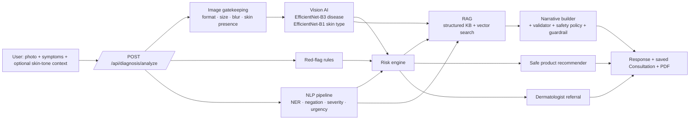
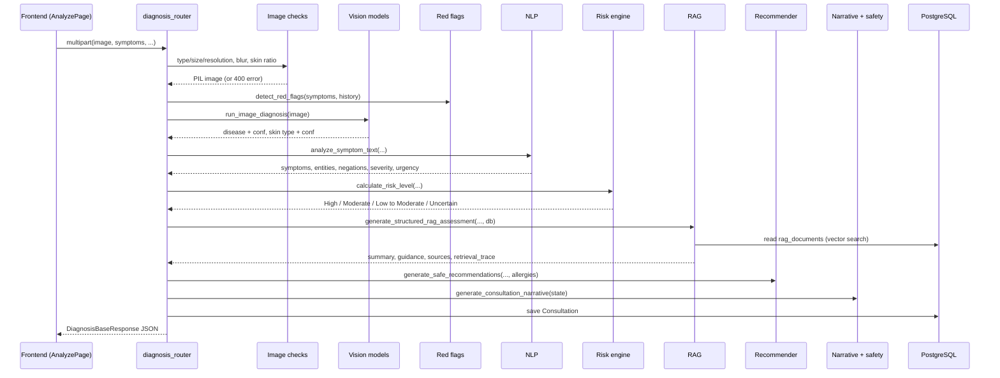
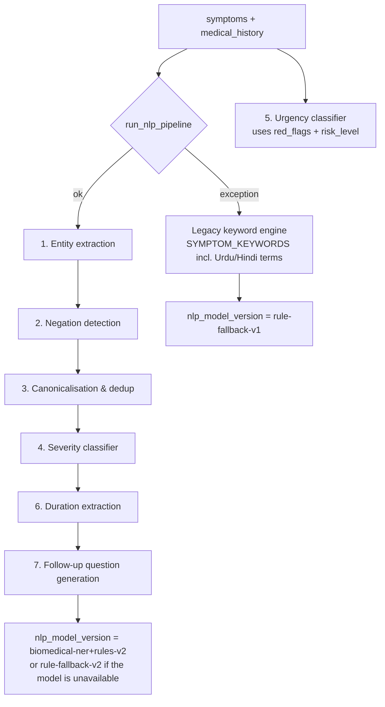
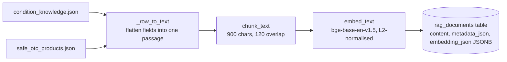
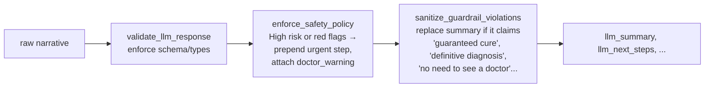

# DermaSoul AI — Project Explained

How the **computer-vision models**, the **NLP pipeline**, the **RAG layer**, and the **safety/narrative layer** work, and how they are wired together into one `/api/diagnosis/analyze` request.

> Everything here is written from the actual source code in `backend/app/` (October 2026). File references are given as `path:line` so you can jump straight to the code.

---

## Table of contents

1. [Big picture](#1-big-picture)
2. [End-to-end request flow](#2-end-to-end-request-flow)
3. [Stage 0 — Image gatekeeping (validation, blur, skin check)](#3-stage-0--image-gatekeeping)
4. [Stage 1 — AI image models (disease + skin type)](#4-stage-1--ai-image-models)
5. [Stage 2 — Red-flag detection](#5-stage-2--red-flag-detection)
6. [Stage 3 — NLP pipeline](#6-stage-3--nlp-pipeline)
7. [Stage 4 — Risk level and doctor warning](#7-stage-4--risk-level-and-doctor-warning)
8. [Stage 5 — RAG (Retrieval-Augmented Generation)](#8-stage-5--rag)
9. [Stage 6 — Safe product recommendations](#9-stage-6--safe-product-recommendations)
10. [Stage 7 — Inclusive skin-tone (melanin) context](#10-stage-7--inclusive-skin-tone-context)
11. [Stage 8 — Referral, education, narrative ("LLM" layer) and safety policy](#11-stage-8--referral-education-narrative-and-safety-policy)
12. [Stage 9 — Metrics, tracing, persistence, alerts](#12-stage-9--metrics-tracing-persistence-alerts)
13. [Models on disk & configuration](#13-models-on-disk--configuration)
14. [Fallback strategy (graceful degradation)](#14-fallback-strategy)
15. [Admin AI endpoints](#15-admin-ai-endpoints)
16. [Model training (Kaggle notebook)](#16-model-training)
17. [Known gaps & observations in the current code](#17-known-gaps--observations)
18. [File map](#18-file-map)
19. [The whole project in simple words](#19-the-whole-project-in-simple-words)

---

## 1. Big picture

DermaSoul AI is a **multimodal, safety-first dermatology support system**. A user uploads a skin photo and describes symptoms in free text. The backend (FastAPI + PostgreSQL) combines four kinds of intelligence:

| Layer | What it does | Technology |
|---|---|---|
| **Vision AI** | Classifies the image into 1 of 22 skin conditions and 1 of 3 skin types | PyTorch EfficientNet-B3 (disease), EfficientNet-B1 (skin type) |
| **NLP** | Reads the symptom text: entities, negation, severity, urgency, duration, follow-up questions | Hugging Face token-classification NER (`biomedical-ner-all`, DistilBERT) + rule-based classifiers, with keyword fallback |
| **RAG** | Grounds the explanation and care guidance in a curated, validated knowledge base | Two retrieval paths: (1) structured scoring over `condition_knowledge.json`, (2) semantic vector search over chunked docs in the `rag_documents` table using `bge-base-en-v1.5` embeddings |
| **Safety & narrative** | Red flags, risk level, doctor warning, product filtering, guardrails, final narrative | Deterministic rules (no generative LLM is called at runtime) |

The design principle throughout: **AI models produce signals; deterministic, auditable rules decide what is shown to the user.** Every AI component has a non-AI fallback, so the endpoint keeps working even if a model fails to load.



---

## 2. End-to-end request flow

Everything is orchestrated in one function: `analyze_skin_image` in `backend/app/routers/diagnosis_router.py:109`. The order matters, because later stages consume earlier outputs.

**Inputs (multipart form):** `image` (required), `symptoms` (required, 5–2000 chars), `duration`, `severity` (`mild|moderate|severe|unknown`), `medical_history` (≤2000 chars), and optional inclusive-context fields `skin_tone`, `fitzpatrick_type` (I–VI), `ethnicity_region`. The user must be authenticated (JWT).

| # | Step | Function | File |
|---|---|---|---|
| 1 | Read bytes, validate type/size/resolution, open as RGB | `validate_uploaded_image` | `services/image_validation_service.py:99` |
| 2 | Reject blurry photos (Laplacian variance) | `validate_image_not_blurry` | `services/skin_detection_service.py:14` |
| 3 | Reject non-skin images / screenshots | `validate_visible_skin` | `services/skin_detection_service.py:81` |
| 4 | Store the image on disk | `save_uploaded_image_bytes` | `services/image_storage_service.py` |
| 5 | Clean & validate text fields | `validate_symptoms`, `validate_severity`, `clean_optional_text` | `routers/diagnosis_router.py:49-106` |
| 6 | **Red-flag detection** on symptoms + history | `detect_red_flags` | `services/red_flag_service.py:75` |
| 7 | **Vision inference** (disease + skin type) | `run_image_diagnosis` | `services/diagnosis_service.py:32` |
| 8 | **NLP analysis** | `analyze_symptom_text` → `run_nlp_pipeline` | `services/nlp_service.py:221`, `services/nlp_pipeline.py:28` |
| 9 | **Risk level** | `calculate_risk_level` | `services/red_flag_service.py:94` |
| 9b | Re-classify urgency with the final risk level | `refresh_urgency` | `services/nlp_pipeline.py` |
| 10 | Doctor warning text | `generate_doctor_warning` | `services/red_flag_service.py:135` |
| 11 | **RAG assessment** | `generate_structured_rag_assessment` | `services/rag_service.py:457` |
| 12 | Trace log | `new_trace_id`, `log_trace_event` | `services/trace_service.py` |
| 13 | Load profile → known allergies | DB query on `Profile` | router |
| 14 | **Safe recommendations** | `generate_safe_recommendations` | `services/recommendation_service.py:218` |
| 15 | Melanin / skin-tone context | `build_melanin_context_note` | `services/melanin_context_service.py:4` |
| 16 | Dermatologist referrals (top 3) | `select_referral_dermatologists` | `services/dermatologist_service.py` |
| 17 | Suggested education article | `suggest_article_for_diagnosis` | `services/education_service.py` |
| 18 | **Narrative** (validated + safety-enforced) | `generate_consultation_narrative` | `services/ai_orchestrator_service.py:78` |
| 19 | Retrieval quality metrics | `compute_retrieval_quality_metrics` | `services/evaluation_service.py:6` |
| 20 | Persist everything as a `Consultation` row | `save_consultation_result` | `services/report_service.py:6` |
| 21 | Email alert if risk is High | `send_high_risk_alert_email` | `services/notification_service.py` |

The response shape is enforced by the Pydantic model `DiagnosisBaseResponse` (`schemas/diagnosis_schema.py:6`), so every stage's keys end up as one flat JSON object.



---

## 3. Stage 0 — Image gatekeeping

Before any AI runs, the image must pass three gates. Each failure returns **HTTP 400** with a user-friendly message, so garbage never reaches the classifier.

1. **File validation** (`image_validation_service.py`)
   - Content type must be `image/jpeg` or `image/png`; extension `jpg/jpeg/png`.
   - Size ≤ `MAX_IMAGE_SIZE_MB` (10 MB default).
   - `PIL.Image.verify()` catches corrupt files; then re-opened and converted to RGB.
   - Minimum resolution 128×128.

2. **Blur check** (`skin_detection_service.py:7`)
   - Grayscale → `cv2.Laplacian(...).var()`. Variance below **20.0** = blurry → rejected.
   - The score is returned to the client as `blur_score`.

3. **Visible-skin check** (`skin_detection_service.py:81`)
   - Computes the fraction of skin-coloured pixels in two colour spaces:
     - **YCrCb**: Cr ∈ [133,173], Cb ∈ [77,127]
     - **HSV**: hue 0–25 or 160–180, sat ≥ 20, val ≥ 40
   - Computes **Canny edge density** (UI screenshots have many hard edges).
   - Rejection rules:
     - best skin ratio < 3 % → "No visible skin".
     - best < 5 % **and** worst < 2 % → "does not look like a close skin photo".
     - edge density > 4.5 % **and** best ratio < 8 % → "screenshot or non-skin scene".
   - Returned to client as `skin_check` (`ycrcb_skin_ratio`, `hsv_skin_ratio`, `combined_skin_ratio`, `edge_density`).

---

## 4. Stage 1 — AI image models

Two independent CNN classifiers, both loaded lazily (first request) and cached as module-level singletons. They run on CUDA if available, otherwise CPU.

### 4.1 Disease classifier — EfficientNet-B3
- Code: `backend/app/ml/disease_model.py`
- Weights: `backend/app/ml/ml_models/diagnosis_model_optimized.pth` (~43 MB)
- Architecture: `torchvision.models.efficientnet_b3(weights=None, num_classes=22)` and the checkpoint is loaded with `strict=True` (accepts either a raw `state_dict` or a dict with `model_state_dict`).
- Preprocessing (`ml/preprocessing.py`): resize to **300×300**, `ToTensor`, ImageNet mean/std normalisation.
- Inference: `softmax(logits)` → `argmax` → label + probability.
- **22 classes** (`ml/class_labels.py`):
  Acne, Actinic Keratosis, Benign Tumors, Bullous, Candidiasis, Drug Eruption, Eczema, Infestations/Bites, Lichen, Lupus, Moles, Psoriasis, Rosacea, Seborrheic Keratoses, Skin Cancer, Sun/Sunlight Damage, Tinea, Unknown/Normal, Vascular Tumors, Vasculitis, Vitiligo, Warts.

### 4.2 Skin-type classifier — EfficientNet-B1
- Code: `backend/app/ml/skin_type_model.py`
- Weights: `backend/app/ml/ml_models/skin_type_model.pth` (~26 MB)
- Input **240×240**, same normalisation. **3 classes**: `dry`, `normal`, `oily`.

### 4.3 Wrapping (`services/diagnosis_service.py`)
`run_image_diagnosis` runs both models on the same PIL image and returns:

```json
{
  "predicted_disease": "Eczema",
  "disease_confidence": 0.81,
  "disease_confidence_level": "High",
  "predicted_skin_type": "dry",
  "skin_type_confidence": 0.67,
  "skin_type_confidence_level": "Medium"
}
```

Confidence is rounded and bucketed by `utils/response_formatter.py` (`round_confidence`, `get_confidence_level`).

**Why this matters downstream:** `predicted_disease` is the **primary key** into the RAG knowledge base (it must equal a `model_class` in `condition_knowledge.json`), into the risk engine, into product filtering, the referral matcher and the education suggester. `predicted_skin_type` drives skin-type-specific care text and product scoring.

---

## 5. Stage 2 — Red-flag detection

`services/red_flag_service.py:75` — pure keyword rules over `symptoms + medical_history` (lower-cased substring match). Runs **before** NLP and before the model, so emergencies are never missed because of a model error.

| Flag | Example triggers |
|---|---|
| `rapidly_spreading` | "rapidly spreading", "spreading fast" |
| `fever_with_skin_issue` | "fever", "chills", "high temperature" |
| `severe_pain` | "severe pain", "unbearable pain" |
| `pus_or_infection` | "pus", "oozing", "yellow discharge", "infected" |
| `bleeding_lesion` | "bleeding mole", "bleeding lesion" |
| `changing_mole` | "mole changed", "irregular mole", "mole getting bigger" |
| `breathing_or_face_swelling` | "difficulty breathing", "swollen lips", "face swelling" |
| `open_wound` | "open wound", "ulcer" |

Output: sorted list of flag names, e.g. `["fever_with_skin_issue", "pus_or_infection"]`. These feed the NLP urgency classifier, the risk engine, RAG scoring, product blocking and the safety policy.

---

## 6. Stage 3 — NLP pipeline

Entry point: `analyze_symptom_text` (`services/nlp_service.py:221`). It **tries the modern pipeline first and falls back to the legacy rule engine on any exception.**



### 6.1 Entity extraction — `services/nlp_entities_service.py`
- **Primary:** Hugging Face `pipeline("token-classification", aggregation_strategy="first")` using the local model at `app/ml/hf_models/biomedical-ner-all` (`DistilBertForTokenClassification`, 84 BIO tags covering 42 biomedical entity types such as `Sign_symptom`, `Biological_structure`, `Disease_disorder`, `Medication`, `Severity`, `Duration`, `Color`, `Texture`…).
  - Loaded once via `@lru_cache`; optionally warmed at startup (`NLP_ENTITY_WARMUP_ON_START`).
  - `"first"` aggregation keeps whole words (`"simple"` produced pieces like `it` + `##chy`). Entity text is sliced from the original sentence using `start`/`end`.
  - Input is cut to `NLP_ENTITY_MAX_LENGTH` (256) tokens by `_truncate_for_model`, using tokenizer offsets. The pipeline itself does not accept `truncation=`/`max_length=`; passing them made every call fail before this fix.
  - Model labels are mapped onto the pipeline's labels by `MODEL_LABEL_MAP`: `Sign_symptom`/`Disease_disorder → SYMPTOM`, `Biological_structure → BODY_PART`, `Medication → MEDICATION`, `Duration`/`Date → DURATION`. Descriptor labels (`Color`, `Texture`, `Detailed_description`…) count as `SYMPTOM` only for known skin terms (red, scaly, burning…).
  - Each entity → `{text, label, normalized, confidence, start, end, source}` where `source` is `model` or `rules`.
- **Rules (always merged):** a regex keyword map with labels `SYMPTOM`, `BODY_PART`, `MEDICATION`, `ALLERGY` (confidence 0.62), including Roman-Urdu/Hindi terms (`khujli`, `jalan`, `dard`, `soojan`, `daane`, `khushk`, `laal`). Its hits are **merged with** the model's, so results never contain fewer terms than the rules alone. If the model is unavailable, only the rules run.

### 6.2 Negation — `services/nlp_negation_service.py`
NegEx-style window: a cue (`no`, `not`, `without`, `denies`, `never`) followed within ~20 characters by the term marks it as negated. Example: *"itchy but **no pain**"* → `pain` is negated and removed from `extracted_symptoms`, listed in `negated_entities`.

### 6.3 Normalisation — `services/nlp_normalization_service.py`
`CANONICAL_ENTITY_MAP` collapses surface forms: `itch/itchy → itching`, `pus/oozing/discharge → pus_or_discharge`, `pimple/acne → acne_or_pimples`, `peeling → skin_peeling`, etc. `deduplicate_canonical` keeps order and removes duplicates.

### 6.4 Severity classifier — `services/nlp_classification_service.py:40`
| Result | Condition | Confidence |
|---|---|---|
| `severe` | text contains "unbearable", "severe pain", "difficulty breathing", "rapidly spreading", "bleeding", "high fever" | 0.88 |
| `moderate` | "painful", "burning", "swelling", "pus", "oozing" **or** any symptom extracted | 0.70 |
| `unknown` | otherwise | 0.45 |

If the user selected a severity in the form, **the user's choice overrides** the classifier.

### 6.5 Urgency classifier — `nlp_classification_service.py:49`
| Result | Condition |
|---|---|
| `high` (0.90) | any red flag, or risk = High, or urgent phrases (face/lip swelling, breathing…) |
| `moderate` (0.68) | risk is Moderate/Uncertain |
| `low` (0.75) | otherwise |

NLP runs before the risk level exists, so the pipeline first classifies urgency with `"Uncertain"`. After `calculate_risk_level`, the router calls `refresh_urgency` to re-classify it with the real risk level and to add or remove the urgency follow-up question.

### 6.6 Duration & follow-ups (`nlp_pipeline.py`)
- Duration: user field, else regex `N days/weeks/months/years`, else the model's `DURATION` entity (e.g. "a year").
- Follow-up questions generated when information is missing:
  - no duration → *"How long has this been present and is it getting worse?"*
  - no `BODY_PART` entity → *"Which exact body area is affected?"*
  - urgency high/moderate → *"Any fever, discharge, bleeding, or breathing symptoms right now?"*

### 6.7 Legacy fallback (`nlp_service.py`)
Only used if `run_nlp_pipeline` raises (entity errors are already handled inside the entity service, so this is rare). A complete keyword engine with 18 symptom groups, **including Roman-Urdu/Hindi words** (`khujli` = itching, `jalan` = burning, `dard` = pain, `soojan` = swelling, `daane` = rash, `khushk` = dry, `laal` = red). Also understands relative durations ("since yesterday", "few weeks"). Returns the same keys so downstream code never breaks.

### 6.8 NLP output contract
`extracted_symptoms`, `symptom_keyword_hits`, `clinical_entities`, `negated_entities`, `extracted_duration`, `inferred_severity`, `severity_rationale`, `severity_confidence`, `urgency_class`, `urgency_confidence`, `urgency_rationale`, `followup_candidates`, `conversation_turn_count`, `nlp_model_version`.

---

## 7. Stage 4 — Risk level and doctor warning

`calculate_risk_level` (`red_flag_service.py:94`) fuses **vision + NLP + rules** in a strict priority order:

```
1. any red flag                                   → High
2. predicted disease ∈ {Skin Cancer, ...}         → High
3. NLP inferred_severity == "severe"              → High
4. disease ∈ MODERATE_RISK set AND confidence≥0.5 → Moderate
   (Eczema, Psoriasis, Rosacea, Bullous, Drug Eruption, Vasculitis, Lupus, Tinea, Candidiasis)
5. NLP inferred_severity == "moderate"            → Moderate
6. disease confidence < 0.5                       → Uncertain
7. otherwise                                      → Low to Moderate
```

`generate_doctor_warning` turns the level into a user-facing message and always appends a **global skin-safety note** (avoid steroid-mixed creams, unverified bleaching products, aggressive treatments on melanin-rich skin).

The risk level is the main **control signal** for everything that follows: RAG scoring boosts, what guidance is shown, which products are blocked, whether the narrative is escalated, whether doctors are referred and whether an alert email is sent.

---

## 8. Stage 5 — RAG

Entry: `generate_structured_rag_assessment` (`services/rag_service.py:457`).

DermaSoul's RAG is **retrieval-augmented, template-generated**: retrieval selects trusted content, and the "generation" is deterministic assembly of that content into sections. No free-form LLM writes medical text, which eliminates hallucinated medical advice.

### 8.1 Knowledge base
Located in `backend/app/rag_knowledge/`:

| File | Contents |
|---|---|
| `condition_knowledge.json` | **22 entries**, one per model class. Fields: `condition_name`, `model_class`, `aliases`, `category`, `brief_overview`, `common_signs`, `common_triggers_or_causes`, `general_care_guidance`, `otc_support_guidance`, `what_to_avoid`, `red_flags`, `when_to_seek_doctor`, `professional_note`, `source_names`, `source_urls` |
| `safe_otc_products.json` | **18 product categories** (not brands) with `product_type` (`supportive_skincare`, `barrier_support`, `preventive_skincare`, `otc_active`, `pharmacist_guided_otc`, …), `recommended_for_conditions/skin_types`, `avoid_for_conditions`, `avoid_if_red_flags`, `avoid_if_allergic_to`, `safety_note` |

`rag_loader_service.py` loads `condition_knowledge.json` once (`lru_cache`) and **schema-validates every entry** (all 15 required fields, list fields are lists, text fields non-empty). A malformed knowledge file fails loudly instead of silently producing bad advice.

### 8.2 Path A — Structured (exact) retrieval
1. **Primary entry lookup:** `get_condition_by_model_class(predicted_disease)` — exact match between the classifier's label and `model_class`. This is the backbone of the answer.
2. **Scored retrieval:** `retrieve_relevant_entries` scores every entry with `calculate_entry_score`:

| Signal | Points |
|---|---|
| `model_class` == predicted disease | +100 |
| `condition_name` == predicted disease | +80 |
| predicted disease in `aliases` | +60 |
| extracted symptom exactly in `common_signs` | +8 |
| symptom ⊂ sign or sign ⊂ symptom (per sign) | +4 |
| symptom overlaps a trigger | +2 |
| detected red flag overlaps entry's red flags | +6 |
| risk High and category ∈ {cancer_warning, sun_damage_precancerous, reaction, blistering, autoimmune, vascular_inflammatory} | +3 |

   The top 6 are kept and combined with Path B to choose **related conditions** (§8.4). Symptom terms are compared with underscores turned into spaces (`pus_or_discharge` → `pus or discharge`).

### 8.3 Path B — Semantic vector retrieval (dense RAG)
Runs only when a DB session is supplied (always, from the router).

**Offline indexing** (`rag_ingestion_service.py`, triggered by `POST /api/admin/ai/reindex-rag`):

- Reindex **deletes all rows then rebuilds** (idempotent).
- `RAGDocument` (`models/rag_document.py`): `id, source_type, source_id, title, content, chunk_index, metadata_json, embedding_json, created_at, updated_at`.

**Online query** (per request). Two searches, both limited to `source_type="condition_knowledge"` (product chunks are left to the recommender):
1. **Trace query** = `predicted_disease + extracted_symptoms + "<skin type> skin"` → `retrieve_semantic_context` (cosine, top-12) → `rerank_context` (top-5). This becomes `retrieval_trace`, which feeds narrative citations and retrieval metrics.
2. **Symptom query** = `extracted_symptoms + red-flag phrases` (no disease name, so results aren't biased toward look-alikes of the prediction), top-8. Used only to pick related conditions.
3. `rerank_context` sets `rerank_score` and `retrieval_confidence` = raw cosine clipped to [0, 1]. The old `(score+1)/2` turned every match into ~0.8+. The bge-reranker cross-encoder is still not called; this is a sort plus top-N.
4. Rows whose embedding size differs from the query vector are skipped with a warning to reindex, instead of being compared on overlapping dimensions.

**Embedding fallback:** if `sentence-transformers` or the model can't load, `_hash_embedding` produces a deterministic 384-dim SHA-256-based vector so the pipeline never crashes. It is not semantically meaningful, and against a 768-dim index all rows are skipped, so Path B returns nothing rather than noise.

### 8.4 Generation (deterministic assembly)
**Related conditions (hybrid A + B).** `select_related_conditions` ranks conditions other than the predicted one by Path A score (≥ 8, scaled to ≤ 1) plus their best symptom-query cosine (≥ 0.6), and returns up to 2 **validated KB entries** (never raw chunk text). They are used only when the image prediction is weak (`disease_confidence < 0.5`) or the symptoms don't match the predicted condition's `common_signs`. A clear-cut prediction keeps its focused answer.

Using the primary entry, the related conditions and the model/NLP/risk outputs, these builders produce the user-facing sections:

| Output field | Builder | Built from |
|---|---|---|
| `assessment_summary` | `build_assessment_summary` | disease + confidence, skin type + confidence, symptoms, risk (+ melanin note) |
| `condition_explanation` | primary entry `brief_overview` (+ melanin note) | KB |
| `symptom_context` | `build_symptom_context` | overlap of NLP symptoms with KB `common_signs` ("overlap is not enough to confirm a diagnosis"), plus "The described symptoms also resemble X and Y…" when related conditions are found |
| `skin_type_context` | `build_skin_type_context` | skin-type model |
| `general_care_guidance` | `build_general_care_guidance` | KB + skin-type tips + melanin tips, de-duplicated |
| `otc_support_guidance` | `build_otc_support_guidance` | KB |
| `what_to_avoid` | `build_what_to_avoid` | KB + melanin avoidances (bleaching, steroid-mixed creams, aggressive exfoliation) |
| `safety_precautions` | `build_safety_precautions` | detected red flags + urgent text if High + KB red flags + "Warning signs for <related condition>: …" + doctor warning |
| `when_to_seek_doctor` | `build_when_to_seek_doctor` | doctor warning if High, else KB |
| `professional_note` | KB | |
| `ai_limitations` | fixed disclaimer | |
| `knowledge_sources` | `build_knowledge_sources` | KB `source_names/urls` of the primary and related entries, each tagged with `condition` |
| `retrieved_knowledge` | | primary + related condition names + trace titles |
| `retrieval_trace`, `retrieval_confidence` | Path B trace query | |

If no KB entry exists for the predicted class, safe generic text is used and the result is flagged as uncertain.

---

## 9. Stage 6 — Safe product recommendations

`generate_safe_recommendations` (`services/recommendation_service.py:218`). This is a **hybrid knowledge source + hard-filter + score** recommender.

1. **Sources:** `safe_otc_products.json` + admin-managed `Product` rows from the DB (DB products are prepended → `recommendation_source = "hybrid"`).
2. **Hard filters** (product removed):
   - disease ∈ `avoid_for_conditions`
   - user's **known allergies** (from Profile, split on `, ; | newline`) overlap `avoid_if_allergic_to`
   - any detected red flag ∈ `avoid_if_red_flags`
3. **Scoring:** +50 condition match, +20 skin-type match, +10 gentle product types; if risk High: +15 for basic supportive items (cleanser, moisturiser, sunscreen, cold compress) and **−100 for active/pharmacist products**; any red flag: −100 for `otc_active`. Score ≤ 0 → dropped.
4. Top **4** returned, plus a `recommendation_safety_note` that becomes stricter as risk rises, and a melanin note when skin-tone context was provided. `allergy_filter_applied` tells the UI whether allergies were considered.

Result: a high-risk user never gets active treatments suggested — only supportive care plus "see a doctor".

---

## 10. Stage 7 — Inclusive skin-tone context

Optional inputs `skin_tone`, `fitzpatrick_type`, `ethnicity_region` flow into three places:
- **RAG** (`build_melanin_adjustment_context`, `build_melanin_care_guidance`, `build_what_to_avoid`): explains that redness may look brown/grey/purple on darker skin, warns about post-inflammatory hyperpigmentation (Fitzpatrick III–VI or brown/deep/medium tones), adds sunscreen and anti-bleaching guidance.
- **Recommendations** (`build_melanin_recommendation_note`).
- **Standalone context** (`melanin_context_service.py`) → `melanin_context_note` + `skin_tone_considerations` (always returned; extra line for IV–VI).

---

## 11. Stage 8 — Referral, education, narrative and safety policy

### 11.1 Dermatologist referral
`select_referral_dermatologists` scores active dermatologists by years of experience, predicted disease vs. specialties/supported conditions, risk level, NLP `urgency_class` and language, and returns the top 3 with `referral_score` and `referral_reasons`.

### 11.2 Education
`suggest_article_for_diagnosis` picks a published education article matching the predicted condition → `suggested_education_slug/title`.

### 11.3 Narrative orchestrator (the "LLM" layer)
`generate_consultation_narrative` (`services/ai_orchestrator_service.py:78`).

> A local generative LLM (**Qwen2.5-1.5B-Instruct**) is present in `app/ml/hf_models/`, and the response still uses `llm_*` field names, but **the conversational LLM was removed from the runtime path**. The narrative is now built by `_deterministic_consultation_narrative` and reported as `generation_mode = "deterministic_rules"`.

It produces:
- `summary` — the RAG `assessment_summary` (or a safe default)
- `differential_notes` — generic look-alike / context caveats
- `next_steps` — RAG `general_care_guidance` (max 8) + `when_to_seek_doctor`
- `followup_questions` — NLP `followup_candidates`
- `citations` — top-5 `retrieval_trace` items
- `confidence_statement`

Then it passes through a **three-layer safety chain** (kept from the LLM design, so an LLM can be plugged back in safely):



---

## 12. Stage 9 — Metrics, tracing, persistence, alerts

- **Retrieval metrics** (`evaluation_service.py`): `retrieval_avg_score`, `retrieval_max_score`, `citation_count` from the retrieval trace — stored per consultation for later RAG quality evaluation.
- **Tracing** (`trace_service.py`): every request gets a UUID `trace_id`; `rag_assessment_completed` is logged with disease, risk and retrieval confidence (logger `ai-trace`). The `trace_id` is returned and stored so a consultation can be correlated with logs.
- **Persistence** (`report_service.py`): **every** AI output (vision, NLP, risk, RAG, recommendations, narrative, metrics, referrals) is saved in one `Consultation` row. This powers consultation history, the admin dashboard and the **PDF report** (`pdf_report_service.py`).
- **Alerts**: if risk is High, `send_high_risk_alert_email` notifies the user (when SMTP is enabled).

---

## 13. Models on disk & configuration

| Model | Path | Used? | Purpose |
|---|---|---|---|
| EfficientNet-B3 (22 cls) | `app/ml/ml_models/diagnosis_model_optimized.pth` | ✅ | disease classification |
| EfficientNet-B1 (3 cls) | `app/ml/ml_models/skin_type_model.pth` | ✅ | skin type |
| biomedical-ner-all (DistilBERT) | `app/ml/hf_models/biomedical-ner-all` | ✅ | clinical NER |
| bge-base-en-v1.5 | `app/ml/hf_models/bge-base-en-v1.5` | ✅ | RAG embeddings (768-dim) |
| bge-reranker-base | `app/ml/hf_models/bge-reranker-base` | ⚠️ configured, not called | future cross-encoder reranker |
| Qwen2.5-1.5B-Instruct | `app/ml/hf_models/Qwen2.5-1.5B-Instruct` | ❌ not referenced in code | former/future narrative LLM |

Key settings (`backend/app/config.py`, overridable in `backend/.env`):

| Setting | Default | Meaning |
|---|---|---|
| `DIAGNOSIS_MODEL_PATH`, `SKIN_TYPE_MODEL_PATH` | `app/ml/ml_models/...` | CNN weights |
| `NLP_ENTITY_MODEL` | local `biomedical-ner-all` | NER model (empty → keyword fallback) |
| `NLP_ENTITY_MAX_LENGTH` | 256 | NER truncation |
| `NLP_ENTITY_WARMUP_ON_START` | False | preload NER in FastAPI lifespan |
| `NLP_HF_HUB_OFFLINE` | True | sets `HF_HUB_OFFLINE=1` (local-only loading) |
| `HF_CACHE_DIR` | `backend/.hf-cache` | Hugging Face cache (`HF_HOME`) |
| `RAG_EMBEDDING_MODEL` | local `bge-base-en-v1.5` | embedding model (empty → hash fallback) |
| `RAG_RERANKER_MODEL` | local `bge-reranker-base` | reserved |
| `REDIS_URL` | `redis://localhost:6379/0` | reserved for background jobs (redis/rq/celery are in requirements; reindex currently runs synchronously) |

Python AI dependencies (`backend/requirements.txt`): `torch 2.11`, `torchvision 0.26`, `transformers 4.57.1`, `sentence-transformers 5.1.1`, `opencv-python`, `numpy`, `pillow`.

---

## 14. Fallback strategy

| Component | Primary | Fallback | Trigger |
|---|---|---|---|
| NLP pipeline | `run_nlp_pipeline` | legacy keyword engine (`rule-fallback-v1`) | any exception |
| NER | transformer NER | regex keyword NER (conf 0.62) | load error / empty result |
| Embeddings | bge-base-en-v1.5 | SHA-256 hash vector (384-dim) | model/library unavailable |
| Knowledge entry | KB entry for class | generic safe text | class not in KB |
| Recommendations | JSON + DB products | JSON only | no DB products |
| Narrative | deterministic builder | validator fills defaults | missing/invalid fields |
| Image models | — | none: missing `.pth` raises `FileNotFoundError` | the only hard dependency |

---

## 15. Admin AI endpoints

In `routers/admin_router.py` (admin JWT required):
- `GET /api/admin/ai/model-registry` — static snapshot from `model_registry.py` (disease_model, skin_type_model, nlp_entity_model, embedding_model).
- `POST /api/admin/ai/reindex-rag` — rebuilds the `rag_documents` vector index from the JSON knowledge files; returns `{"inserted_chunks": N}`. **Run this after editing the knowledge JSON or after first setup** — otherwise Path B returns nothing.

---

## 16. Model training

`dermatology_kaggle_training_notebook.ipynb` trains the disease model on the **DermNet** dataset (Kaggle `shubhamgoel27/dermnet`):
- Maps DermNet folder names onto the app's 22 labels via an explicit `CLASS_MAP` (the notebook warns that raw DermNet folder names do not match the app labels).
- 85/15 random train/validation split, seed 42.
- Same preprocessing as inference (300×300, ImageNet normalisation) + augmentation (horizontal flip, ±15° rotation).
- `efficientnet_b3(weights=None, num_classes=22)`, **class-weighted** `CrossEntropyLoss`, `AdamW(lr=1e-4, wd=1e-4)`, `CosineAnnealingLR`, 20 epochs, batch 32.
- Tracks accuracy, macro-F1 and confusion matrix; saves the best `state_dict` as `diagnosis_model_optimized.pth` (target ≈85 % validation accuracy).
- Copy the file to `backend/app/ml/ml_models/` to deploy.

The label order in the notebook **must** match `ml/class_labels.py`, because the app maps output indices to names by position.

---

## 17. Known gaps & observations

Found while reading the code — worth knowing for maintenance, viva/defence questions, or the next iteration:

**Fixed (October 2026):**
- ~~The NER model never ran.~~ `truncation=`/`max_length=` made every call fail, so the regex fallback was silently used. Fixed with manual truncation (§6.1).
- ~~NER label mismatch and word-piece splitting.~~ Fixed with `MODEL_LABEL_MAP` and `"first"` aggregation; rule hits are now always merged in.
- ~~Wrong `nlp_model_version`.~~ Now `biomedical-ner+rules-v2` or `rule-fallback-v2`, depending on what actually ran. (The admin model registry still says "pubmedbert-or-fallback".)
- ~~Urgency evaluated with `risk_level="Uncertain"`.~~ The router now calls `refresh_urgency` after the risk level is known.
- ~~Path A `retrieved_entries` unused; vector hits only used as titles.~~ Both now choose related conditions, which change `symptom_context`, `safety_precautions` and `knowledge_sources` (§8.4).
- ~~Inflated `retrieval_confidence`.~~ Now raw cosine. Consultations saved before this change hold the old, higher scale, so don't compare the two directly.
- ~~Dimension mismatch compared silently.~~ Mismatched rows are now skipped with a warning.

**Still open:**
1. **Red-flag negation (fixed).** `detect_red_flags` still uses the same keyword matching, but ignores a keyword the user explicitly denies ("no fever", "not spreading quickly", "without pus"). The cue must be within 3 words before the keyword and in the same clause, so "no itching, but fever" is still flagged.
2. **Reranker is a pass-through** — `bge-reranker-base` is configured but no cross-encoder is called.
3. **Vector search is brute-force** — all condition rows are loaded and scored in Python each request (two queries now). Fine for ~40 chunks; for a large corpus, move to `pgvector`.
4. **Index must be built manually** via the admin endpoint; there's no automatic indexing at startup.
5. **Qwen2.5 LLM** (~3 GB) ships in the repo but is unused; the `llm_*` response fields are filled deterministically.
6. **Severity classifier:** any extracted symptom bumps severity to `moderate`, which then makes risk at least `Moderate`. Now that NLP finds more symptoms, more cases are rated `Moderate`.
7. **Product chunks** are still indexed in `rag_documents` but no longer searched (the recommender reads the JSON directly).
8. **Tests** — all backend tests (including `test_validators.py`, which now checks the real `UserRegisterRequest` email rule) run with `python -m unittest discover -s ../tests/backend -t ../tests/backend` from `backend/` with `PYTHONPATH=.`; pytest is not needed.
9. **Other fixes** — `GET /api/dermatologists?include_inactive=true` returns inactive entries to admins only, and unexpected server errors return a clean JSON 500 and are logged with tracebacks to `backend/logs/dermasoul.log`.

---

## 18. File map

```
backend/app/
├── routers/diagnosis_router.py        # orchestrates the full pipeline (POST /api/diagnosis/analyze)
├── routers/admin_router.py            # /ai/model-registry, /ai/reindex-rag
├── ml/
│   ├── class_labels.py                # 22 disease + 3 skin-type labels
│   ├── preprocessing.py               # torchvision transforms
│   ├── disease_model.py               # EfficientNet-B3 wrapper
│   ├── skin_type_model.py             # EfficientNet-B1 wrapper
│   ├── ml_models/*.pth                # trained weights
│   └── hf_models/                     # local NER, embedding, reranker, LLM
├── services/
│   ├── image_validation_service.py    # type/size/resolution
│   ├── skin_detection_service.py      # blur + skin presence + screenshot detection
│   ├── diagnosis_service.py           # runs both CNNs
│   ├── red_flag_service.py            # red flags, risk level, doctor warning
│   ├── nlp_service.py                 # NLP entry + legacy fallback
│   ├── nlp_pipeline.py                # modern NLP pipeline
│   ├── nlp_entities_service.py        # transformer NER + fallback
│   ├── nlp_negation_service.py        # negation
│   ├── nlp_normalization_service.py   # canonical terms
│   ├── nlp_classification_service.py  # severity & urgency
│   ├── rag_service.py                 # RAG orchestration + section builders
│   ├── rag_loader_service.py          # KB loading & schema validation
│   ├── rag_ingestion_service.py       # JSON → chunks → embeddings → DB
│   ├── rag_chunking_service.py        # 900/120 char chunker
│   ├── rag_embedding_service.py       # bge embeddings + hash fallback
│   ├── rag_retrieval_service.py       # cosine vector search
│   ├── rag_rerank_service.py          # top-N + confidence
│   ├── recommendation_service.py      # safe OTC recommender
│   ├── melanin_context_service.py     # skin-tone context
│   ├── ai_orchestrator_service.py     # narrative builder
│   ├── llm_response_validator.py      # output contract
│   ├── safety_policy_service.py       # escalation enforcement
│   ├── clinical_guardrail_service.py  # unsafe-claim filter
│   ├── evaluation_service.py          # retrieval metrics
│   ├── trace_service.py               # trace IDs
│   ├── model_registry.py              # registry snapshot
│   └── report_service.py              # saves Consultation
├── rag_knowledge/
│   ├── condition_knowledge.json       # 22 condition entries
│   └── safe_otc_products.json         # 18 product categories
├── models/rag_document.py             # vector index table
└── tasks/rag_tasks.py                 # reindex job
dermatology_kaggle_training_notebook.ipynb   # disease model training
```

---

## 19. The whole project in simple words

Everything above is the technical version. This section explains the same thing in plain language, without code or jargon.

### What is DermaSoul AI?

DermaSoul AI is an app that helps people understand a skin problem. You take a photo of your skin, write a few lines about how it feels (for example "itchy and red for two weeks"), and the app gives you:

- a **best guess** of what the skin condition might be,
- **how serious** it might be,
- **simple care tips** and things to avoid,
- **safe product types** that may help,
- and, if needed, a clear message to **see a skin doctor** (with a list of suggested doctors).

It does **not** replace a doctor. It is a helper that gives safe, careful guidance.

### The main idea: "AI suggests, rules decide"

The app uses AI to look at the photo and read the text, but the AI does **not** get the final say. Fixed safety rules, written by people, decide what the user actually sees. This makes the app predictable and safe: it can't suddenly invent dangerous medical advice.

### Step by step: what happens when you press "Analyze"

Think of it like a patient visiting a clinic and passing through different desks.

**1. The front desk checks the photo**
Before anything else, the app checks that the photo is usable:
- Is it really a picture (JPG or PNG), and not too big or too small?
- Is it **sharp**, not blurry?
- Does it actually **show skin**, and not a screenshot, a wall or a pet?

If the photo fails, the user gets a friendly message to try again. Bad photos never reach the AI.

**2. The "eyes": looking at the photo**
Two AI models look at the photo. They were trained on thousands of skin pictures.
- The first one guesses the **skin condition** from a list of 22 (for example Acne, Eczema, Psoriasis, Moles, Skin Cancer…).
- The second one guesses the **skin type**: dry, normal or oily.

Each guess comes with a **confidence score**, like "81% sure". If the AI is not very sure, the app says so.

**3. The alarm check: looking for danger signs**
The app scans what the user wrote for warning words such as "fever", "bleeding mole", "pus", "spreading fast", "difficulty breathing" or "swollen lips". These are called **red flags**.
This is a simple word search, so it works even if all the AI fails. Emergencies are never missed because of a computer error.

**4. The "ears": understanding the text (NLP)**
Another AI reads the user's description the way a nurse would:
- It picks out **symptoms** and **body parts** ("itching", "on my arm").
- It understands **"no"**: in "itchy but no pain", it knows there is *no* pain.
- It groups similar words together ("itch", "itchy" → "itching").
- It estimates how **severe** and how **urgent** it sounds.
- It finds **how long** the problem has lasted ("3 weeks").
- If something important is missing, it prepares **follow-up questions**, like "Which body area is affected?"

If this AI fails, a simpler backup takes over that just looks for known words. It even understands some Roman-Urdu/Hindi words like *khujli* (itching), *jalan* (burning) and *dard* (pain).

**5. The risk decision**
Now the app combines everything (the photo guess, the danger signs and the text) and gives one **risk level**:

| Risk level | Simple meaning |
|---|---|
| **High** | Danger signs found, or a serious condition like skin cancer is suspected. See a doctor soon. |
| **Moderate** | A condition that usually needs proper treatment (e.g. eczema, psoriasis). |
| **Low to Moderate** | Probably mild, but keep an eye on it. |
| **Uncertain** | The AI isn't sure enough to say. |

Danger signs always win: if there is a red flag, the result is **High**, no matter what the photo AI thinks.

**6. The library: finding trusted information (RAG)**
The app has its own small, checked "medical library": one page of trusted information for each of the 22 conditions, plus a list of safe product types.

"RAG" simply means: **look things up in the trusted library first, then build the answer from what you found.** The app:
- opens the library page for the guessed condition,
- also searches the library by *meaning* (not just exact words) to find other helpful passages,
- and puts the answer together from these trusted pieces.

The important part: **no AI writes medical advice freely.** The text the user reads comes from the checked library, so the app can't "make things up".

**7. Safe product suggestions**
The app suggests up to 4 **types** of products (for example "gentle cleanser" or "fragrance-free moisturiser", not brand names). It removes anything that:
- is not suitable for the guessed condition,
- contains something the user is **allergic to** (taken from their profile),
- or could be risky when there are danger signs.

If the risk is High, the app only suggests very basic, gentle care and tells the user to see a doctor. It never suggests strong treatments in that case.

**8. Care for darker skin tones**
If the user shares their skin tone, the app adds extra advice. For example: on darker skin, redness can look brown, grey or purple; dark marks can stay after healing; and bleaching creams or creams mixed with steroids should be avoided.

**9. Extra help**
- **Doctor suggestions:** the app picks the 3 skin doctors that best match the condition, urgency and language.
- **Reading material:** it suggests an education article about the condition.

**10. Writing the final answer, with safety checks**
The app writes a clear final summary with next steps, follow-up questions and the sources it used. Before showing it, three safety checks run:
1. Is the answer complete and in the right shape?
2. If the risk is High, is an urgent "see a doctor" message at the top?
3. Does it contain any dangerous promises like "guaranteed cure" or "no need to see a doctor"? If yes, that text is replaced.

**11. Saving and alerts**
- Everything is saved as a **consultation**, so the user can see their history and download a **PDF report**.
- Each request gets a tracking number to help developers find problems.
- If the risk is High, the app can send the user an **email alert**.

### The backup plan (why the app rarely breaks)

Almost every smart part has a simpler backup:

| If this fails… | …the app uses this instead |
|---|---|
| The text-reading AI | A simple keyword search |
| The meaning-based library search | A basic backup search |
| No library page for a condition | Safe, general advice |
| Products from the database | The built-in product list |

The only part with no backup is the photo AI. If its model files are missing, the analysis cannot run.

### How the photo AI learned

The skin-condition model was trained on a public collection of skin photos called **DermNet**. It was shown many labelled pictures again and again (20 rounds) until it learned to recognise the patterns of each condition, aiming for about 85% accuracy on photos it had not seen before.

### Things that could be improved

Recently fixed:
- The text-reading AI was crashing on every request without anyone noticing, so only the simple keyword list was being used. It now really runs, understands whole words, and its results are combined with the keyword list, which also understands words like *khujli* and *jalan*.
- Urgency is now checked after the risk level is known, so mild cases can be "low".
- The library search now really affects the answer: when the photo AI is unsure, or the symptoms don't fit its guess, the app also names up to two similar conditions and their warning signs.
- The confidence score for the library search is now honest instead of always looking high.

Fixed since:
- The danger-sign check now understands "no": "no fever" no longer counts as a fever warning, but "no itching, but fever" still does.

Still open:
- A "re-ranking" step and a larger chat-style AI model are included in the project but **not actually used** yet.
- The library search checks every passage one by one. That's fine now, but it would be slow if the library grew a lot.
- After changing the library, an admin must **manually rebuild** the search index.

### In one sentence

DermaSoul AI looks at your skin photo, reads how you describe it, checks for danger signs, looks up trusted information, and gives you safe, simple guidance, always pointing you to a real doctor when it matters.
