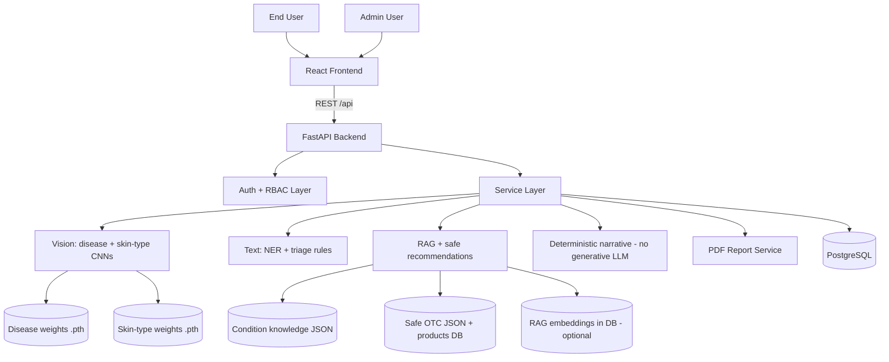
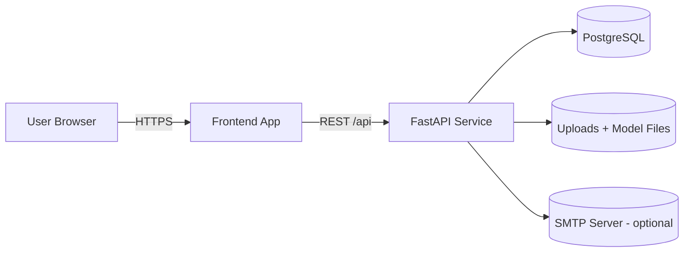
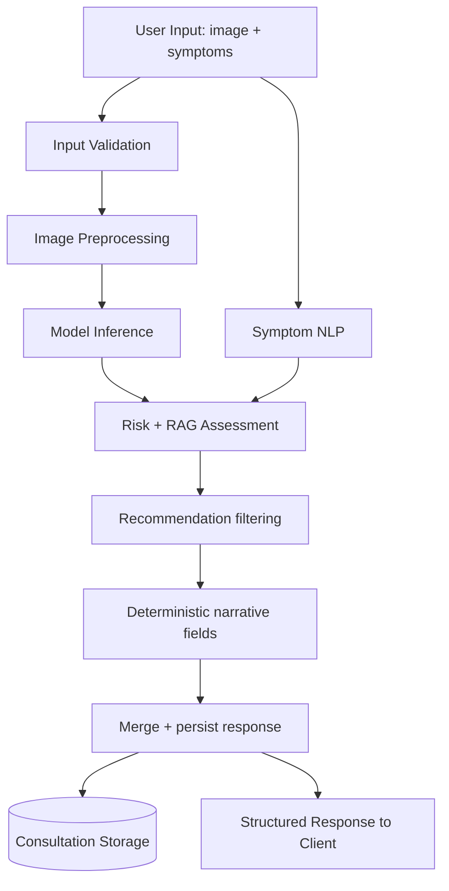
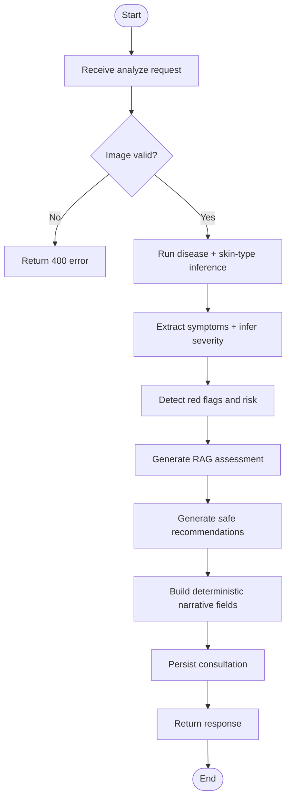
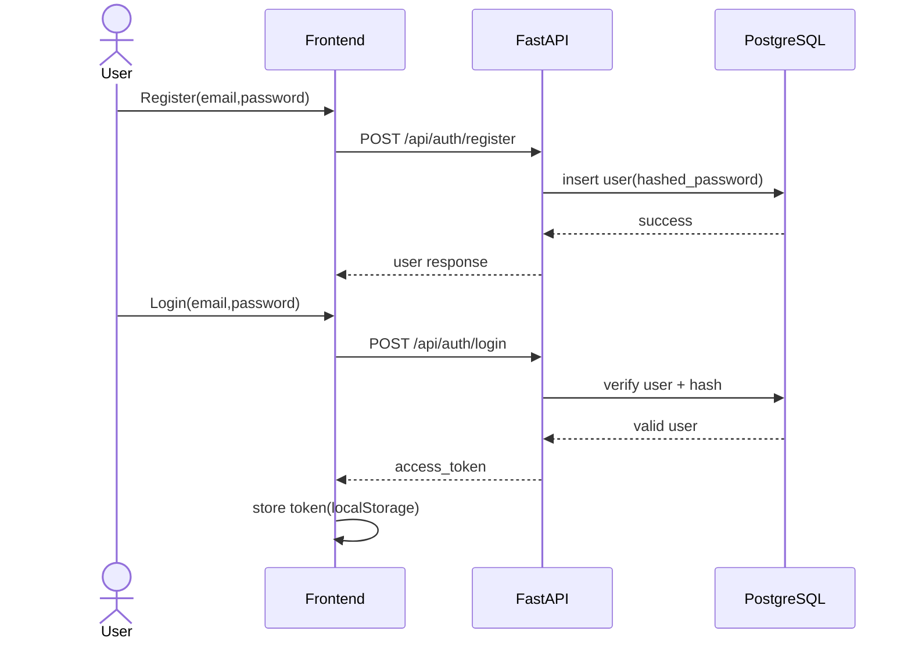
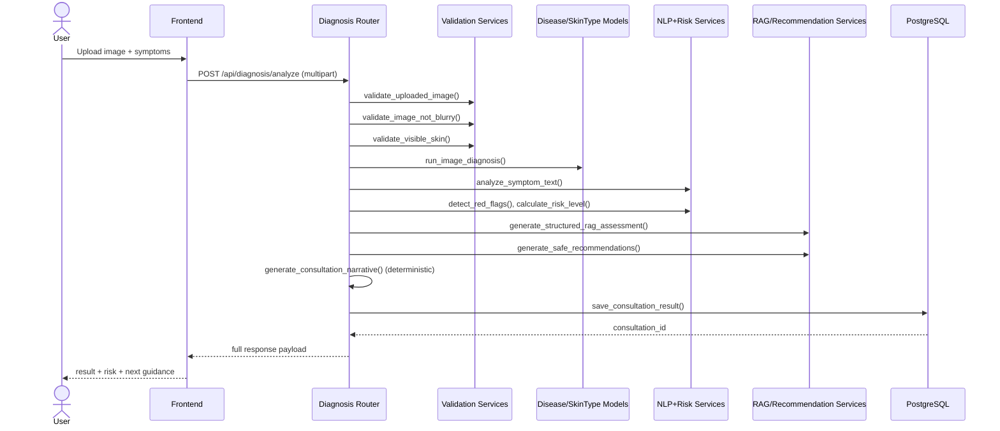
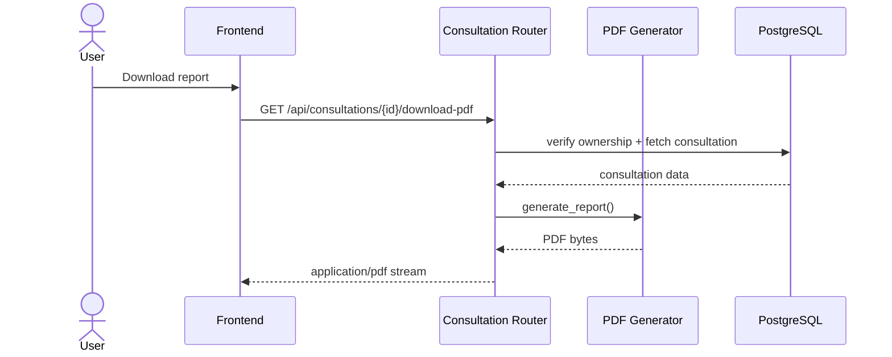
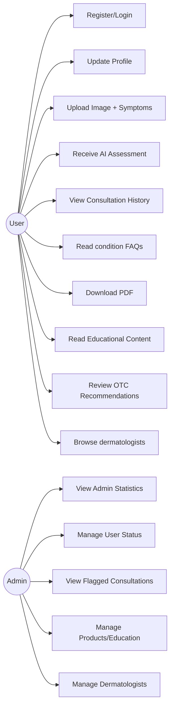

# DermaSoul AI - Comprehensive Software Design and Implementation Document

DermaSoul AI is a full-stack dermatology support platform combining medical image analysis, symptom-text interpretation, risk triage, retrieval-augmented educational guidance, and personalized OTC support recommendations.

This document is intentionally detailed for:
- project onboarding,
- academic/report submission,
- software engineering documentation,
- implementation and testing traceability.

> **Run it on your computer:** follow **[SETUP.md](SETUP.md)** (one command on Windows: `powershell -ExecutionPolicy Bypass -File .\setup.ps1`).

> Clinical disclaimer: The platform provides educational AI-assisted support and does not replace licensed medical diagnosis.

## Latest update highlights (May 2026)

- **Consultation follow-up** uses **curated condition FAQs** in the React app (`/app/consultations/:id/faq`), mapped from `predicted_disease` to static knowledge — **no conversational LLM** and no `…/messages` chat API.
- **Consultation narrative fields** (`llm_*` columns) are filled by a **deterministic orchestrator** (`generate_consultation_narrative`) from RAG, NLP, and triage state — not by a generative model.
- **ML stack** unchanged at the core: EfficientNet-B3 (disease) + EfficientNet-B1 (skin type); optional HF **token-classification NER** and **SentenceTransformers** embeddings for RAG; OpenCV image gates.
- **Configuration** no longer defines `LLM_*` settings; Pydantic ignores stray legacy env keys.
- Dermatologist referral module, inclusive guidance wording, and structured diagnosis responses remain in place.

---

## 1. Introduction

## 1.1 Purpose

DermaSoul AI helps users:
- upload skin images,
- provide symptoms and optional contextual history,
- receive AI-supported condition assessment with confidence and risk cues,
- get safety-first guidance and educational material,
- maintain consultation history (light EHR behavior),
- access role-based administration features.

## 1.2 Scope

In-scope capabilities:
- registration/login and JWT-protected sessions,
- profile and consultation persistence,
- dual-model inference (disease + skin type),
- NLP entity extraction (transformer NER when available) plus rule-based severity/urgency,
- red-flag detection and risk stratification,
- structured RAG explanation generation (curated knowledge + optional semantic retrieval over `RAGDocument` rows),
- deterministic consultation narrative assembly (populates structured summary fields; not generative AI),
- condition-specific **FAQ** content in the frontend (curated, per disease label),
- recommendation filtering with allergy/risk controls,
- PDF report export,
- admin oversight dashboards and controls,
- dermatologist directory and referral attachment on analysis when appropriate.

Out-of-scope (current repository state):
- generative / conversational LLMs for clinical Q&amp;A,
- online training pipeline and experiment tracking service,
- DICOM/PACS integration,
- direct hospital EMR integrations,
- clinician workflow management.

---

## 2. System Overview and Architecture

## 2.1 Technology Stack

### Frontend
- React 19 + TypeScript
- Vite
- Axios
- React Router
- Tailwind-based styling and UI components

### Backend
- FastAPI
- SQLAlchemy ORM
- Pydantic/Pydantic Settings
- Uvicorn
- PyTorch + TorchVision
- OpenCV + Pillow
- ReportLab (PDF generation)

### Data
- PostgreSQL (primary target in environment example)
- JSON/JSONB storage for rich consultation payload fields
- Local JSON knowledge base for RAG/recommendations

## 2.2 Architectural Style

The backend follows a layered, modular architecture:
- Presentation layer (`routers`)
- Business layer (`services`)
- Persistence layer (`models`, `database`)
- Contract layer (`schemas`)
- ML inference layer (`ml`)
- Utilities and scripts (`utils`, `scripts`)

Why:
- keeps endpoints thin,
- centralizes business logic,
- improves maintainability and testability,
- supports future replacement of modules with minimal API disruption.

## 2.3 Frontend Runtime Architecture

- `App.tsx` orchestrates route trees:
  - public routes,
  - authenticated app routes,
  - admin nested routes.
- `AuthContext` manages token lifecycle and user hydration.
- `api/client.ts` centralizes request base URL + auth header injection.
- Pages consume route-specific API wrappers (`src/api/*`).

## 2.4 System Architecture Overview (Diagram)



Curated **condition FAQs** are rendered entirely in the React app from static knowledge keyed by `predicted_disease` (no extra diagram edge to the API).

## 2.5 Technologies and Services

### Core Technologies
- Frontend service: React + Vite SPA.
- API service: FastAPI + Uvicorn.
- Data service: PostgreSQL via SQLAlchemy.
- Inference service: PyTorch/TorchVision model loading and prediction.
- Image service: OpenCV + Pillow validation/preprocessing.
- Reporting service: ReportLab PDF generation.

### Optional/Configurable Services
- SMTP service for high-risk email alerts when enabled.
- Local file storage for uploaded images (`UPLOAD_DIR`).

## 2.6 Step-by-Step Approach (System Runtime)

1. User authenticates and receives JWT token.  
2. User uploads image and enters symptoms/history/context.  
3. Frontend sends multipart request to `/api/diagnosis/analyze`.  
4. Backend validates image format, blur, and visible skin ratio.  
5. Disease model and skin-type model run inference.  
6. NLP rules extract symptom indicators and infer severity cues.  
7. Red-flag engine computes risk level and warning priority.  
8. RAG layer builds structured educational assessment text.  
9. Recommendation engine applies safety filters (allergy/risk constraints).  
10. Deterministic narrative builder maps RAG, NLP, and triage fields into consultation summary slots (`generation_mode`: `deterministic_rules`; not a generative LLM).  
11. Consultation record is persisted in database.  
12. Response is returned and shown in UI with risk + guidance + links.  
13. User can review history, consultation detail, **condition FAQs** (curated frontend content), and download the PDF report.  

## 2.7 User Classes and Characteristics

### Class 1: General User (Patient/End User)
- Registers with email/password.
- Uses profile and analysis features.
- Needs clear language, low-friction UI, and actionable safety messages.
- May have limited technical/medical background.

### Class 2: Admin User
- Monitors users, flagged consultations, and statistics.
- Manages product and education catalogs.
- Requires stronger governance and role-protected access.

### Class 3: Student/Developer Maintainer
- Extends modules, tests, and documentation.
- Needs traceable architecture, stable API contracts, and reproducible local setup.

## 2.8 Operating Environment

### Development Environment
- OS: Windows 10/11 (current setup), also portable to Linux/macOS with equivalent commands.
- Shell: PowerShell/Bash.
- Python: 3.11+ recommended.
- Node.js: 20+ recommended.
- Database: PostgreSQL 14+ recommended.

### Runtime Environment
- Frontend dev server: Vite (default `5173`).
- Backend server: Uvicorn (configured example uses `8010`).
- Localhost networking with CORS/proxy configuration.
- GPU optional; inference falls back to CPU automatically.

### Deployment Environment (Target)
- Reverse-proxied FastAPI service (TLS recommended).
- Built frontend static assets served by web server/CDN.
- Managed PostgreSQL instance.

## 2.9 Requirement Identification Techniques

Requirements for this project can be elicited and validated using:

1. **Stakeholder Interviews:** users, supervisors, domain mentors, healthcare advisors.  
2. **Use-Case Workshops:** define actor goals and exceptions before coding.  
3. **User Story Mapping:** prioritize registration -> analysis -> guidance -> follow-up flows.  
4. **Domain Analysis:** review dermatology triage workflows and safety constraints.  
5. **Prototyping + Feedback:** iterate UI forms and response readability with pilot users.  
6. **Regulatory/Safety Review:** validate disclaimers, escalation rules, and data handling boundaries.  
7. **Traceability Matrix:** map each requirement to module, endpoint, and test case.  

## 2.10 Additional Diagrams (Real, Renderable)

## 2.10.1 Deployment Diagram



## 2.10.2 Data Flow Diagram (Level 1)



## 2.10.3 Activity Diagram (Diagnosis Workflow)



---

## 3. Detailed Module Decomposition (core modules)

The project is decomposed into related modules to match software-engineering reporting and implementation ownership (numbered for historical continuity; the **Condition FAQ** UI is an additional frontend module).

## 3.1 Module 1 - User Account Registration and Authentication

**Goal:** secure identity lifecycle and session control.

### Functional Elements (FE)
- FE-1: Register users with unique email.
- FE-2: Login/authentication with JWT bearer token.
- FE-3: Secure credential storage (hashed password, never plaintext).
- FE-4: Account status enforcement (`is_active` check).
- FE-5: Role-aware authorization bootstrap (user/admin).

### Implementation Mapping
- Backend: `routers/auth_router.py`, `services/auth_service.py`, `utils/security.py`.
- Frontend: `contexts/AuthContext.tsx`, login/register pages.

## 3.2 Module 2 - Profile and Electronic Health Record (Consultation History)

**Goal:** maintain longitudinal user and consultation state.

### Functional Elements (FE)
- FE-1: One profile per user.
- FE-2: Create/update user demographic and medical-profile fields.
- FE-3: Store consultation history for each user.
- FE-4: Retrieve detail and list views of consultations.
- FE-5: Allow user-owned deletion and secure image retrieval.

### Implementation Mapping
- Profile: `routers/profile_router.py`, `models/profile.py`.
- EHR-like consultation history: `models/consultation.py`, `routers/consultation_router.py`.

## 3.3 Module 3 - Image Acquisition and Skin Analysis

**Goal:** validated image ingestion and condition inference.

### Functional Elements (FE)
- FE-1: Image upload via React frontend (browse/drag/camera).
- FE-2: Support JPG/PNG.
- FE-3: Preprocess images (resize + normalize).
- FE-4: Perform inference via CNN-family backbones (EfficientNet variants).
- FE-5: Detect/classify skin condition labels.
- FE-6: Return predicted condition label + confidence.
- FE-7: Handle invalid/missing/blurred/no-skin images with explicit errors.

### Implementation Mapping
- Frontend: `pages/AnalyzePage.tsx`.
- Backend validation: `services/image_validation_service.py`, `services/skin_detection_service.py`.
- ML: `ml/disease_model.py`, `ml/skin_type_model.py`, `ml/preprocessing.py`.

## 3.4 Module 4 - NLP Interpretation for Symptoms and Medical History

**Goal:** enrich image-only inference with textual context.

### Functional Elements (FE)
- FE-1: Accept symptoms + optional medical history.
- FE-2: Pipeline combines optional **transformer token-classification NER** (`nlp_entities_service`) with **rules** (keywords, negation, severity/urgency classifiers).
- FE-3: Extract clinically relevant indicators and follow-up question prompts.
- FE-4: Infer severity/duration hints from text when needed.
- FE-5: Provide context to integrated assessment and RAG.

### Implementation Mapping
- `services/nlp_service.py`, `services/nlp_pipeline.py`, `services/nlp_entities_service.py`, `services/nlp_classification_service.py`.

## 3.5 Module 5 - Integrated Diagnosis and Assessment

**Goal:** combine vision + NLP + rules into coherent user response.

### Functional Elements (FE)
- FE-1: Generate predicted disease label.
- FE-2: Produce disease confidence score and band.
- FE-3: Generate clear structured response for users.
- FE-4: Highlight urgent/critical cases using red flags and risk level.
- FE-5: Use symptom history and contextual evidence in assessment narrative.
- FE-6: Populate persisted **summary / next-step** fields via `services/ai_orchestrator_service.py` (**deterministic**; no LLM API calls).

### Implementation Mapping
- Orchestration endpoint: `routers/diagnosis_router.py`.
- Risk logic: `services/red_flag_service.py`.
- RAG assessment: `services/rag_service.py`.
- Narrative: `services/ai_orchestrator_service.py` (uses `llm_response_validator` + `safety_policy_service` for shape and escalation, not generative inference).

## 3.5a Module 5a - Condition FAQ (frontend)

**Goal:** give users stable, condition-specific Q&amp;A after a consultation without open-ended chat.

### Implementation Mapping
- `frontend/src/pages/ConsultationFaqPage.tsx`, `frontend/src/lib/conditionFaqs.ts`, data in `frontend/src/constants/conditionKnowledgeData.ts`.
- Route: `/app/consultations/:id/faq` (legacy `/chat` redirects here).

## 3.6 Module 6 - Skin-Type Classification and Personalization

**Goal:** estimate skin type and tailor downstream guidance.

### Functional Elements (FE)
- FE-1: Predict skin type (e.g., dry/oily/normal classes in current label set).
- FE-2: Use dedicated model for skin-type inference.
- FE-3: Return skin-type prediction alongside disease prediction.
- FE-4: Feed personalization logic in guidance/recommendations.

### Implementation Mapping
- `ml/skin_type_model.py`, `services/diagnosis_service.py`.

## 3.7 Module 7 - Personalized Recommendation and Local Treatment Support

**Goal:** safe, explainable OTC/support guidance.

### Functional Elements (FE)
- FE-1: Use local/curated OTC knowledge (JSON + optional DB fusion).
- FE-2: Suggest supportive options based on condition/risk profile.
- FE-3: Provide usage guidance and caution notes.
- FE-4: Include warning and safety constraints.
- FE-5: Support explainability through source-grounded recommendation rationale.

### Implementation Mapping
- `services/recommendation_service.py`.
- Product CRUD: `routers/product_router.py`, `models/product.py`.

## 3.8 Module 8 - Educational Support

**Goal:** condition literacy and preventive-care education.

### Functional Elements (FE)
- FE-1: Provide educational material per common condition.
- FE-2: Present usage guidance, precautions, and limitations.
- FE-3: Present unsafe-practice warnings and referral signs.
- FE-4: Link relevant article from diagnosis output.

### Implementation Mapping
- `routers/education_router.py`, `services/education_service.py`.
- Seed tooling: `scripts/seed_education_articles.py`.

## 3.9 Module 9 - Administration, Auditability, and Reporting

**Goal:** operational control, monitoring, and formal report outputs.

### Functional Elements (FE)
- FE-1: Admin stats (users, active users, consultation metrics).
- FE-2: User account status management.
- FE-3: Access flagged/high-risk consultation views.
- FE-4: PDF report generation for consultation detail.
- FE-5: Controlled admin content management (products/education).

### Implementation Mapping
- `routers/admin_router.py`.
- PDF pipeline: `services/pdf_report_service.py`.

## 3.10 Module 10 - Dermatologist Referral and Care Handoff

**Goal:** provide clinically actionable follow-up pathways when AI triage indicates elevated risk.

### Functional Elements (FE)
- FE-1: Admin can add, update, disable, and delete dermatologist directory entries.
- FE-2: Users can browse active dermatologist directory.
- FE-3: Diagnosis pipeline can attach referral candidates for moderate/high-risk consultations.
- FE-4: Consultation records persist referral note and referred dermatologists.
- FE-5: UI exposes referral information in consultation detail for follow-up action.

### Implementation Mapping
- Backend: `routers/dermatologist_router.py`, `services/dermatologist_service.py`, `models/dermatologist.py`.
- Frontend: `pages/DoctorsPage.tsx`, `pages/AdminDermatologistsPage.tsx`, consultation detail integration.

---

## 4. Functional Requirements

FR-1 The system shall allow user registration with unique email.  
FR-2 The system shall authenticate users and issue bearer token.  
FR-3 The system shall enforce role-based access control for admin routes.  
FR-4 The system shall let users view and update profile fields.  
FR-5 The system shall accept skin image + symptom context for analysis.  
FR-6 The system shall validate image quality and visible skin before inference.  
FR-7 The system shall run disease and skin-type models and return confidence values.  
FR-8 The system shall analyze symptom text and infer severity/duration context.  
FR-9 The system shall detect red flags and classify risk level.  
FR-10 The system shall generate structured educational response text.  
FR-11 The system shall provide recommendations filtered by risk and allergies.  
FR-12 The system shall store complete consultation outputs for history retrieval.  
FR-13 The system shall allow PDF report download of consultation.  
FR-14 The system shall allow users to manage own consultation records.  
FR-15 The system shall expose education and product content APIs with admin CRUD controls.  
FR-16 The system shall allow admins to view high-risk and aggregate system data.  
FR-17 The system shall provide dermatologist directory management for admins.  
FR-18 The system shall provide dermatologist referral visibility to users when clinically appropriate.  
FR-19 The system shall present **curated condition FAQs** in the frontend keyed to `predicted_disease`, without relying on generative LLM chat.

---

## 5. Non-Functional Requirements

NFR-1 **Security:** passwords hashed; token-based access; role checks on admin endpoints.  
NFR-2 **Reliability:** graceful error responses for invalid images, missing resources, and auth failures.  
NFR-3 **Performance:** inference endpoint should return within acceptable UI time budget (target under 2 minutes worst-case due to model execution).  
NFR-4 **Maintainability:** layered backend with clear module boundaries.  
NFR-5 **Usability:** clear response messaging and medical safety disclaimers.  
NFR-6 **Portability:** runnable on local Windows environments and transferable to other systems with setup commands.  
NFR-7 **Scalability (initial):** structured for future migration to workers/queue and production process management.  
NFR-8 **Auditability:** persisted consultation output fields support retrospective review.

---

## 6. Sequence Diagrams

## 6.1 User Registration/Login Sequence



## 6.2 End-to-End Diagnosis Sequence



## 6.3 Consultation PDF Download Sequence



---

## 7. Use Case Diagram (Textual and Mermaid)

## 7.1 Actors
- User (patient/end-user)
- Admin
- AI Inference Engine (internal system component)

## 7.2 Use Cases
- Register / Login
- Manage Profile
- Submit Image + Symptoms
- Receive Assessment
- View Consultation History
- Read **Condition FAQs** (curated; keyed to diagnosed condition label)
- Download PDF Report
- Browse Education
- View Product Suggestions
- Browse **Dermatologist directory** / referral hints from analysis
- Manage Products/Education (Admin)
- Manage **Dermatologist directory** (Admin)
- Monitor Users and Flagged Cases (Admin)



---

## 8. Design Models for Object-Oriented Development Approach

## 8.1 Domain/Class Model (Core Entities)

- `User`
  - attributes: id, email, hashed_password, role, is_active, timestamps
  - relations: one `Profile`, many `Consultation`
- `Profile`
  - attributes: demographic + history fields
  - relation: belongs to `User`
- `Consultation`
  - attributes: image metadata, model outputs, risk fields, guidance, recommendations
  - relation: belongs to `User`
- `Product`
  - attributes: category, ingredients, suitability, cautions
- `EducationArticle`
  - attributes: slug, category, content, warnings, sources

## 8.2 Service Object Model

- `AuthService`: registration/login/password/account lifecycle.
- `DiagnosisService`: unified disease + skin-type prediction.
- `NLPService`: extraction and inference from symptom text.
- `RedFlagService`: risk computation and warning generation.
- `RAGService`: knowledge retrieval and structured explanation synthesis.
- `RecommendationService`: safe recommendation scoring and filtering.
- `ReportService/PDFService`: persistence mapping and PDF export formatting.

## 8.3 OO Design Patterns in Use

- **Facade-like router orchestration:** diagnosis endpoint acts as orchestrator over multiple services.
- **Repository-like ORM abstraction:** SQLAlchemy sessions/entities encapsulate data access.
- **Dependency injection:** FastAPI `Depends` for DB/user/admin dependencies.
- **Single-responsibility service classes/functions:** each service module focuses on one concern.

---

## 9. Design Models for Procedural Approach

The same system can be interpreted procedurally as a set of deterministic pipelines.

## 9.1 Procedural Pipeline (Diagnosis)

1. parse input  
2. validate image  
3. preprocess image  
4. run disease model  
5. run skin-type model  
6. parse symptoms text  
7. detect red flags  
8. assign risk  
9. retrieve knowledge  
10. score recommendations  
11. persist result  
12. return response

## 9.2 Procedural Data Transformations

- Raw file bytes -> PIL image -> tensor -> logits -> probabilities -> label/confidence.
- Raw symptom text -> normalized tokens/phrases -> extracted indicators -> severity/risk signals.
- Aggregated signals -> structured response dictionary -> persisted consultation row.

---

## 10. Data Design

## 10.1 Data Storage Design

- Relational core for identity and transactional consistency (`users`, `profiles`, `consultations`, etc.).
- JSON/JSONB fields in consultations for nested analytics output and evolving schema components.

## 10.2 Data Dictionary (High Level)

- `users.email`: unique identity key.
- `users.role`: authorization pivot.
- `consultations.predicted_disease`: top class output.
- `consultations.disease_confidence`: calibrated confidence value.
- `consultations.risk_level`: triage outcome.
- `consultations.recommendations`: list payload of recommendation objects.
- `consultations.knowledge_sources`: citation/source structure.

## 10.3 Data Integrity and Constraints

- Unique email and article slug constraints.
- Foreign key ownership between user/profile/consultations.
- Ownership check enforced before consultation detail/image/pdf access.
- API-level validation of required fields and allowed value sets.

---

## 11. Project Methodology

Recommended methodology representation for this project: **Iterative Incremental Agile**.

## 11.1 Phases

1. Requirements and risk definition.
2. Data model and API contract design.
3. Baseline auth/profile modules.
4. ML inference integration.
5. NLP/risk/RAG and recommendation integration.
6. Admin/reporting features.
7. Hardening (security/testing/documentation).

## 11.2 Why This Methodology Fits

- AI modules and rule systems evolve iteratively.
- Clinical-safety constraints require repeated review and refinement.
- Frontend UX and backend response contracts need tight feedback loops.

---

## 12. Algorithms (Implemented and Conceptual)

## 12.1 Image Classification Algorithm (Inference)

1. Resize and normalize image tensor.
2. Forward pass through EfficientNet model.
3. Softmax over class logits.
4. Argmax to predicted class.
5. Confidence = max class probability.

## 12.2 Blur Detection Algorithm

1. Convert image to grayscale.
2. Compute Laplacian variance.
3. Compare against blur threshold.
4. Reject if below threshold.

## 12.3 Visible Skin Detection Algorithm

1. Compute YCrCb and HSV conversions.
2. Apply skin-mask threshold bands.
3. Estimate skin-pixel ratio.
4. Reject if ratio below minimum.

## 12.4 Symptom Extraction Algorithm

1. Normalize input text.
2. Run **NER pipeline** when configured (HF token classification on `NLP_ENTITY_MODEL`), else keyword / regex fallback in `nlp_entities_service`.
3. Detect negated symptom phrases.
4. Deduplicate canonical symptom terms; merge with rule-based keyword extraction where applicable.
5. Infer duration and severity from pattern and lexical cues via `nlp_classification_service` rules.

## 12.5 Risk Stratification Algorithm

1. If any red flag -> High.
2. Else if disease in high-risk set -> High.
3. Else if severe inferred severity -> High.
4. Else moderate disease + confidence threshold -> Moderate.
5. Else low confidence -> Uncertain.
6. Else -> Low to Moderate.

## 12.6 Recommendation Scoring Algorithm

1. Load knowledge products (+ optional DB products).
2. Remove blocked/allergy/red-flag conflicts.
3. Score by condition match, skin-type fit, safety profile, risk constraints.
4. Sort descending.
5. Return top-k with safety notes.

---

## 13. Training Results and Model Evaluation

Current repository state:
- model weights are loaded for inference from paths configured in `.env`,
- training scripts/logs/experiment files are not included here.

Therefore, report this section with two subsections:

## 13.1 Available (from current codebase)

- Disease model architecture class: EfficientNet-B3 (`disease_model.py`).
- Skin-type model architecture class: EfficientNet-B1 (`skin_type_model.py`).
- Input preprocessing:
  - disease: 300x300 normalize(ImageNet stats),
  - skin type: 240x240 normalize(ImageNet stats).

## 13.2 To Fill From Training Runs (required for final report)

Add your exact values for:
- Dataset split strategy (train/val/test, counts per class).
- Class imbalance handling (if used).
- Hyperparameters (optimizer, LR schedule, epochs, augmentation).
- Metrics:
  - accuracy,
  - precision/recall/F1 (macro + weighted),
  - AUC (if available),
  - per-class confusion matrix.
- Calibration analysis (optional but recommended for confidence-based triage).
- Failure analysis examples (false positives/false negatives by condition).

Suggested table template:

| Model | Task | Val Acc | Test Acc | Macro F1 | Notes |
|---|---|---:|---:|---:|---|
| EfficientNet-B3 | Disease classification | TODO | TODO | TODO | fill from logs |
| EfficientNet-B1 | Skin-type classification | TODO | TODO | TODO | fill from logs |

---

## 14. Security Techniques (Applicable)

Implemented:
- Password hashing (not plaintext storage).
- JWT bearer-token authentication.
- Role-based access control for admin endpoints.
- Ownership checks for user-specific consultation resources.
- Input validation and strict error handling on image/text fields.
- Defensive recommendation logic for high-risk conditions.

Recommended enhancements:
- rate limiting for auth and analysis endpoints,
- refresh-token rotation and token revocation list,
- encrypted secrets management and periodic secret rotation,
- audit logging for admin actions,
- security headers and stricter CORS policies in production.

---

## 15. External APIs / SDKs / Services Used

No mandatory third-party remote API is required in core runtime flow.

Libraries/SDK-like dependencies used:
- FastAPI and Starlette (web/API framework)
- SQLAlchemy (ORM/data access)
- PyTorch + TorchVision (model execution)
- OpenCV and Pillow (image processing)
- ReportLab (PDF generation)
- React, Vite, Axios, React Router (frontend runtime)

Optional external service path:
- SMTP server can be used for high-risk email alerts when enabled in env.

---

## 16. Guidelines for Students (Development + Submission)

1. Understand module boundaries before coding.  
2. Do not place business logic directly inside routers/pages.  
3. Keep diagnosis safety constraints as highest priority.  
4. Document every new API endpoint with request/response examples.  
5. Validate all user input (client + server).  
6. Preserve backward compatibility for consultation schema whenever possible.  
7. Add tests with every feature change.  
8. Never commit secrets (`.env`, API keys, production credentials).  
9. Keep medical disclaimer visible in user-facing output.  
10. For reports, explicitly separate implemented results vs planned improvements.

Academic report guidance:
- Include architecture diagram + module mapping + test evidence.
- Include confusion matrix and per-class metrics for ML sections.
- Clearly state dataset source, consent/licensing, and limitations.

---

## 17. Testing Strategy (Requested Categories)

## 17.1 Unit Testing

Target units:
- `nlp_service` keyword extraction, severity inference.
- `red_flag_service` risk decision logic.
- `recommendation_service` filtering and scoring.
- `rag_service` normalization and merge utilities.

Examples:
- severity inference for severe phrase patterns,
- allergy conflict detection true/false cases,
- high-risk path forces safer recommendation set.

## 17.2 Functional Testing

Feature-level API/UI outcomes:
- user can register/login and access protected routes,
- analyze endpoint returns full response object on valid input,
- consultation list/detail/delete endpoints behave as expected,
- admin-only routes reject non-admin tokens.

## 17.3 Business Rules Testing

Critical rules to validate:
- red flag present -> risk becomes `High`.
- inactive user cannot proceed as authenticated principal.
- non-owner cannot fetch another user consultation/image/pdf.
- high-risk recommendations exclude risky OTC actives.
- education/product write endpoints require admin role.

## 17.4 Integration Testing

Cross-module flows:
- FE analyze form -> API -> model -> risk -> RAG -> DB -> FE detail view.
- Login token storage -> authorized API call chain.
- Consultation-to-PDF generation integration.
- Admin dashboard metrics from DB aggregation endpoints.

## 17.5 Suggested Test Suite Layout

```text
backend/tests/
  unit/
    test_nlp_service.py
    test_red_flag_service.py
    test_recommendation_service.py
  functional/
    test_auth_endpoints.py
    test_diagnosis_endpoint.py
    test_consultations_endpoints.py
  integration/
    test_end_to_end_analyze_flow.py
    test_admin_workflow.py
```

---

## 18. Deployment and Portability Commands

The complete, tested setup guide for a new computer is **[SETUP.md](SETUP.md)**. In short (Windows):

```powershell
git clone https://github.com/arwadsabahat1/DermaSoul-AI.git
cd DermaSoul-AI
powershell -ExecutionPolicy Bypass -File .\setup.ps1     # one-time setup
powershell -ExecutionPolicy Bypass -File .\start.ps1     # start backend + frontend
```

Prerequisites: Git, **Python 3.12**, **Node.js 22 LTS (22.12+)**, **PostgreSQL 16+**. `setup.ps1` creates `backend\venv`,
installs packages, writes `backend\.env`, downloads the two language models
(`python -m app.scripts.download_models`) and prepares the database (`python -m app.scripts.setup_database`).
See SETUP.md for the manual steps on Windows, macOS and Linux, and for troubleshooting.

---

## 19. Operational Scripts

From `backend` (with active virtualenv):

Create/promote admin:
```powershell
python -m app.scripts.create_admin --email admin@example.com --password "StrongPass123"
```

Seed education:
```powershell
python -m app.scripts.seed_education_articles
```

Seed products:
```powershell
python -m app.scripts.seed_products_from_rag
```

Apply consultation schema extension (required for existing databases):
```powershell
python -m app.scripts.migrate_consultation_referral_fields
```

---

## 20. Future Work Roadmap

- Add Alembic migrations and versioned schema changes.
- Add CI pipeline with lint + tests + build checks.
- Add robust model evaluation artifacts in repository.
- Add production deployment assets (Docker/K8s).
- Add observability (metrics, tracing, structured logs).
- Add equity/robustness audits by skin tone and imaging conditions.

---

## 21. Summary

This project already implements a strong, safety-aware modular foundation for AI-assisted dermatology support.  
The remaining major documentation gap for academic completeness is **empirical model training/evaluation metrics**, which should be imported from your training experiment logs and inserted in Section 13.

---

## 22. Class Diagram (PlantUML)

Complete data model class diagram showing all entities, relationships, and key attributes:

```plantuml
@startuml DermaSoul_ClassDiagram
!define ENTITY_COLOR #E1F5FF
!define RELATION_COLOR #B3E5FC
!define ATTR_COLOR #FFFFFF

skinparam backgroundColor #FAFAFA
skinparam classBackgroundColor ENTITY_COLOR
skinparam classBorderColor #0277BD
skinparam arrowColor #0277BD
skinparam defaultFontSize 11
skinparam defaultFontName Arial

' ==================== USER MANAGEMENT ENTITIES ====================

class User {
    - id: str (PK, UUID)
    - email: str (Unique, Indexed)
    - hashed_password: str
    - role: str {user, admin}
    - is_active: bool (Default: True)
    - created_at: datetime
    - updated_at: datetime
    ---
    + register(email, password): User
    + login(email, password): bool
    + get_role(): str
    + deactivate(): void
    + promote_to_admin(): void
}

class Profile {
    - id: str (PK, UUID)
    - user_id: str (FK -> User, Unique)
    - full_name: str | None
    - age: int | None
    - gender: str | None
    - phone: str | None
    - known_allergies: str | None
    - medical_history: str | None
    - skin_concerns: str | None
    - current_products: str | None
    - created_at: datetime
    - updated_at: datetime
    ---
    + update_profile(data): Profile
    + get_allergies(): list[str]
    + get_medical_history(): str
}

' ==================== CONSULTATION ENTITIES ====================

class Consultation {
    - id: str (PK, UUID)
    - user_id: str (FK -> User, Indexed)
    - image_filename: str | None
    - symptoms: str (Required)
    - duration: str | None
    - severity: str | None
    - medical_history: str | None
    ---
    -- SKIN CONTEXT --
    - skin_tone: str | None
    - fitzpatrick_type: str | None
    - ethnicity_region: str | None
    - melanin_context_note: str | None
    - skin_tone_considerations: JSON | None
    ---
    -- DISEASE DIAGNOSIS --
    - predicted_disease: str (Required)
    - disease_confidence: float
    - disease_confidence_level: str
    ---
    -- SKIN TYPE --
    - predicted_skin_type: str (Required)
    - skin_type_confidence: float
    - skin_type_confidence_level: str
    ---
    -- NLP EXTRACTION --
    - extracted_symptoms: JSON | None
    - symptom_keyword_hits: JSON | None
    - clinical_entities: JSON | None
    - negated_entities: JSON | None
    - extracted_duration: str | None
    ---
    -- SEVERITY & URGENCY --
    - inferred_severity: str | None
    - severity_rationale: str | None
    - severity_confidence: float | None
    - urgency_class: str | None
    - urgency_confidence: float | None
    - urgency_rationale: str | None
    - nlp_model_version: str | None
    ---
    -- RISK ASSESSMENT --
    - red_flags: JSON | None
    - risk_level: str {Low, Medium, High}
    - doctor_warning: str (Required)
    ---
    -- CLINICAL GUIDANCE --
    - assessment_summary: str | None
    - condition_explanation: str | None
    - symptom_context: str | None
    - skin_type_context: str | None
    - general_care_guidance: JSON | None
    - otc_support_guidance: JSON | None
    - what_to_avoid: JSON | None
    - safety_precautions: JSON | None
    - when_to_seek_doctor: str | None
    - professional_note: str | None
    - ai_limitations: str | None
    ---
    -- RAG RETRIEVAL --
    - retrieved_knowledge: JSON | None
    - knowledge_sources: JSON | None
    - retrieval_trace: JSON | None
    - retrieval_confidence: float | None
    - retrieval_metrics: JSON | None
    ---
    -- RECOMMENDATIONS --
    - recommendations: JSON | None
    - recommendation_safety_note: str | None
    - recommendation_source: str | None
    - allergy_filter_applied: str | None
    ---
    -- NARRATIVE GENERATION --
    - llm_summary: str | None
    - llm_differential_notes: JSON | None
    - llm_next_steps: JSON | None
    - llm_followup_questions: JSON | None
    - llm_confidence_statement: str | None
    - llm_generation_mode: str | None
    ---
    -- REFERRAL --
    - referred_dermatologists: JSON | None
    - referral_note: str | None
    - trace_id: str | None
    ---
    -- METADATA --
    - created_at: datetime
    ---
    + get_risk_level(): str
    + has_red_flags(): bool
    + get_recommendations(): list[Recommendation]
    + generate_pdf_report(): bytes
    + get_referred_doctors(): list[Dermatologist]
}

class ConsultationMessage {
    - id: str (PK, UUID)
    - consultation_id: str (FK -> Consultation)
    - sender_role: str {user, system}
    - message_text: str
    - message_type: str {text, image, alert}
    - created_at: datetime
    ---
    + create_message(text): ConsultationMessage
    + is_system_message(): bool
}

' ==================== REFERENCE DATA ENTITIES ====================

class Product {
    - id: str (PK, UUID)
    - name: str (Required)
    - brand: str | None
    - category: str (Required)
    - ingredients: str | None
    - suitable_skin_types: str | None
    - supported_conditions: str | None
    - avoid_if_allergic_to: str | None
    - contraindications: str | None
    - price_range: str | None
    - availability: str | None
    - product_url: str | None
    - created_at: datetime
    - updated_at: datetime
    ---
    + is_safe_for_allergy(allergy): bool
    + is_suitable_for_conditions(conditions): bool
    + get_ingredients_list(): list[str]
    + get_availability_info(): dict
}

class EducationArticle {
    - id: str (PK, UUID)
    - title: str (Required, ≤200 chars)
    - slug: str (Unique, Indexed)
    - category: str (Required)
    - summary: str | None
    - content: str (Required, ≥20 chars)
    - warnings: str | None
    - precautions: str | None
    - when_to_seek_doctor: str | None
    - source_urls: str | None
    - created_at: datetime
    - updated_at: datetime
    ---
    + get_by_slug(slug): EducationArticle
    + get_by_category(category): list[EducationArticle]
    + search(query): list[EducationArticle]
    + get_warnings(): str
    + get_precautions(): str
}

class Dermatologist {
    - id: str (PK, UUID)
    - full_name: str (Required)
    - clinic_name: str | None
    - city: str | None
    - country: str | None
    - specialties: str | None (comma-separated)
    - supported_conditions: str | None (comma-separated)
    - specialty_tags: str | None (comma-separated)
    - regions_served: str | None
    - languages: str | None
    - telemedicine_available: bool (Default: False)
    - emergency_available: bool (Default: False)
    - years_experience: int | None
    - contact_email: str | None
    - contact_phone: str | None
    - booking_url: str | None
    - notes: str | None
    - is_active: bool (Default: True)
    - created_at: datetime
    - updated_at: datetime
    ---
    + supports_condition(condition): bool
    + is_available_for_telemedicine(): bool
    + get_contact_info(): dict
    + get_booking_link(): str
    + search_by_condition(condition): list[Dermatologist]
    + search_by_region(region): list[Dermatologist]
}

class RAGDocument {
    - id: str (PK, UUID)
    - document_type: str {condition, treatment, ingredient}
    - title: str
    - content: str
    - source: str | None
    - embedding: vector | None
    - metadata: JSON | None
    - created_at: datetime
    - updated_at: datetime
    ---
    + search_similar(query, top_k): list[RAGDocument]
    + get_embedding(): vector
    + compute_relevance_score(query): float
}

' ==================== RELATIONSHIPS ====================

User "1" --> "0..1" Profile: has_profile
User "1" --> "0..*" Consultation: creates

Consultation "1" --> "0..*" ConsultationMessage: has_messages
Consultation "0..*" --> "0..*" Product: recommends
Consultation "0..*" --> "0..*" Dermatologist: refers_to
Consultation "0..*" --> "0..*" RAGDocument: uses_for_rag

Product "0..*" --> "0..*" EducationArticle: related_to
EducationArticle "0..*" --> "0..*" Dermatologist: referenced_by

' ==================== ADDITIONAL NOTES ====================

note right of User
  - Role-based access control: user vs admin
  - Passwords hashed using bcrypt
  - JWT tokens for session management
  - Soft deletion via is_active flag
end note

note right of Profile
  - One-to-one relationship with User
  - Optional fields for flexible profiles
  - Allergy information used for safety filtering
  - Medical history for context
end note

note right of Consultation
  - Complete consultation record with all AI results
  - Immutable once created (for audit trail)
  - Contains full diagnostic pipeline output
  - Risk stratification based on red flags
  - Multiple relationship references to products/doctors
  - JSON fields for flexible data structures
end note

note right of Product
  - OTC products for safe recommendations
  - Contraindications and allergy warnings
  - Suitable skin types and conditions
  - Pricing and availability info
  - Product URLs for external links
end note

note right of EducationArticle
  - Disease/condition knowledge base
  - Slug for URL-friendly access
  - Safety warnings and precautions
  - Medical guidance and doctor visit triggers
  - Source URLs for citations
end note

note right of Dermatologist
  - Directory of referral specialists
  - Multi-condition support
  - Telemedicine capability tracking
  - Multi-language support
  - Emergency availability flags
end note

note right of RAGDocument
  - Retrieval-Augmented Generation source
  - Vector embeddings for semantic search
  - Multiple document types support
  - Metadata for filtering and ranking
  - Used for context-aware recommendations
end note

@enduml
```



### Class Diagram Legend

**Color Coding:**
- **Blue (Entity Color)**: Primary data entities
- **Arrows**: Relationships between entities
  - Solid line: Direct association
  - Diamond: Multiplicity (0..1, 0..*, 1, etc.)

**Key Relationships:**

1. **User → Profile**: One-to-one (each user has optional profile)
2. **User → Consultation**: One-to-many (user creates multiple consultations)
3. **Consultation → ConsultationMessage**: One-to-many (multiple messages per consultation)
4. **Consultation → Product**: Many-to-many (consultation recommends products)
5. **Consultation → Dermatologist**: Many-to-many (consultation refers to doctors)
6. **Consultation → RAGDocument**: Many-to-many (uses knowledge documents)
7. **Product ↔ EducationArticle**: Many-to-many (products related to conditions)
8. **EducationArticle ↔ Dermatologist**: Many-to-many (articles mention specialists)

**Field Patterns:**

- **JSON Fields**: Flexible structures for complex data
  - `extracted_symptoms`, `recommendations`, `metadata`
  - Allows future extensibility without schema changes
  - Indexed in PostgreSQL for search

- **Confidence Scores** (0-1 floats):
  - `disease_confidence`, `skin_type_confidence`
  - Used for triage and decision thresholds

- **Enum-like Strings**:
  - `role`: user, admin
  - `risk_level`: Low, Medium, High
  - `sender_role`: user, system
  - `document_type`: condition, treatment, ingredient

- **Timestamps**: `created_at`, `updated_at` on all entities
  - Audit trail for compliance
  - UTC timezone for consistency

**Data Integrity Constraints:**

- **Unique Constraints**: email, user_id (in Profile), slug (in EducationArticle)
- **Foreign Keys**: CASCADE delete for orphan prevention
- **Indexes**: On frequently queried fields (email, user_id, slug)
- **Not Null**: Critical fields like id, email, predicted_disease, risk_level

**Scalability Considerations:**

- JSON/JSONB fields enable schema flexibility
- Vector field (RAGDocument) supports semantic search
- Partitioning recommendation: Consultation by created_at
- Archival: Move old consultations to read-only storage
- Caching: Product and EducationArticle candidates for Redis

